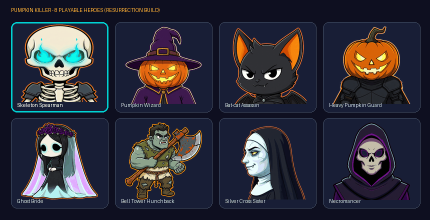
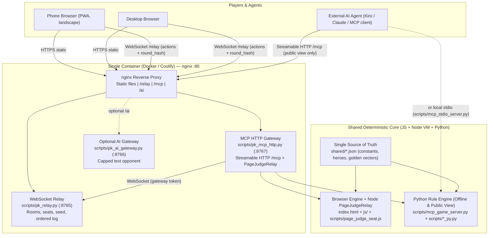
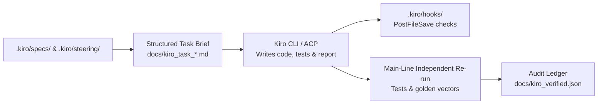

# Pumpkin Killer

**A Flash-era artillery duel, resurrected for the modern browser — phone, computer, and AI agents at one table.** Up to three heroes per side throw across a haunted fence while wind and weather shift every shot. Built for **Kiroween 2026 (Resurrection)** with Kiro specs, steering, hooks, custom agents, a Kiro Power (`play` skill), and a standard MCP server (`.kiro/`).

**[▶ Play now: pumpkin.jace0423.com](https://pumpkin.jace0423.com)** (phone in landscape, or any desktop browser)

**Why it matters.** Adobe ended Flash Player at the end of 2020, and the easy way to play Flash-era artillery duels went with it. Pumpkin Killer brings that duel back to the browser on phone and computer, and adds a seat an AI agent can take fairly: it gets only the public game state, with no random seed and no ballistic simulator ([protocol](docs/mcp_agent_protocol.md)).



- **8 heroes** (Skeleton Spearman, Pumpkin Wizard, Bat-cat Assassin, Necromancer, Silver Cross Sister, Ghost Bride, Bell Tower Hunchback, Heavy Pumpkin Guard), each with a distinct weapon arc, status effects, and ultimate.
- **4 battlefields** and **5 weather states** (clear, rain, storm, snow, fog) with shifting wind every round.
- **1 v 1, 2 v 2, and 3 v 3** team matches across desktop browsers, mobile phones (landscape PWA), built-in AI, and external MCP agents.

---

## System Architecture

Every device and the Python engine run the exact same deterministic rules from the same match seed. The relay never simulates a match — it only manages rooms, seats, and ordered action forwarding, while per-round state hashes (`round_hash`) verify that every client stays in lockstep.



Full architecture diagrams, match sequence flows, deployment details, and known limits: [`docs/ARCHITECTURE_FULL_20261124.md`](docs/ARCHITECTURE_FULL_20261124.md).

---

## Tech Stack

| Layer | Technology | Details |
|---|---|---|
| **Game Client** | Vanilla HTML5 Canvas, ES JavaScript, CSS3, PWA | Zero frontend framework; `1920x1080` canvas with fixed `1/60 s` physics, offline cache (`sw.js`, `manifest.webmanifest`), QR invites (`js/qr_code.js`), i18n (`js/i18n.js`). |
| **Backend & Relay** | Python 3.12, `websockets==15.0.1` | Minimal runtime footprint (`requirements.txt`); in-memory WebSocket relay (`scripts/pk_relay.py`) with 6-char room codes, invite tickets, reconnect grace, and rate/size guards. |
| **AI Agent Interface** | Model Context Protocol (MCP) — stdio & Streamable HTTP | **11 tools** (7 game + 4 room: `join_room`, `lock_hero`, `leave_room`, `wait_for_turn`) via `scripts/mcp_stdio_server.py`, `scripts/pk_mcp_http.py`, and **`PageJudgeRelay`** (`scripts/page_judge_seat.js` running real `index.html` in Node.js 22); strict public-information isolation (`public_throw()`). |
| **Cross-Runtime Determinism** | Shared JSON + Node.js 22 & Python parity | Shared constants, hit masks, and golden vectors (`shared/*.json`) verified identically in JS (`js/determinism.js`) and Python (`scripts/determinism_py.py`), checked live via `round_hash`. |
| **Testing & Simulation** | Node.js, Python `unittest`, Headless Chrome | **216 `test_*` scripts** (`112 JS + 1 MJS + 103 Python`) + `sim_team_headless.py`, seeded property-based tests (`scripts/test_properties.js`), mixed 3v3 E2E (`0 out_of_sync`). |
| **Deployment** | Docker (`python:3.12-alpine` + `nginx` + `nodejs`), Coolify | Single-container image (`deploy/Dockerfile.coolify`); Nginx on port 80 proxies loopback-only Python/Node services with container healthchecks. |

---

## Play & Quick Start

### 1. Run Locally (Desktop)
```sh
pip install -r requirements.txt
python3 -B scripts/dev_server.py 8080 --with-relay
```
Open `http://127.0.0.1:8080/`. The `--with-relay` flag starts the local WebSocket room relay (requires `websockets`); without it, single-player mode works out of the box.

### 2. Play on Phone or Against a Friend
- **Phone**: Open https://pumpkin.jace0423.com in landscape (every device draws the same screen layout; wider screens are filled at the sides) and optionally install it to your home screen as a full-screen PWA.
- **Multiplayer Room**: Choose **1 v 1**, **2 v 2**, or **3 v 3** on the start screen and press **Play with friends**. After a one-time display name, the **Lobby** opens with a 6-character code, copy-link button, **Join code**, and QR code — friends join in any browser with zero install. Players take red/white places, lock distinct heroes (no duplicate hero on a team), and return to the same lobby for rematches.

### 3. Play with AI or Bring Your Own Agent (MCP)
- **Built-in Computer Opponent**: In single-player matches, empty seats are played by the built-in AI (**Easy**, **Normal**, **Hard**, or **Smart (online)** when the server AI gateway is enabled).
- **Lobby AI Fill (Multiplayer)**: With **Computer fills open places** ticked in the lobby, the host's **Start** fills open places with computer seats running in the host's browser at zero server cost (or fill from the terminal via `python3 -B scripts/fill_room.py`).
- **External AI Agent (MCP)**: In the lobby, tick **Allow agents** so any seated player can click **Invite an agent** to generate a one-use ticket with URL, room code, and hosted `/mcp` instructions (full walkthrough in [`docs/HOST_AGENT_HOWTO.md`](docs/HOST_AGENT_HOWTO.md), or connect locally with `python3 -B scripts/make_agent_join_config.py`).
  - Runs with the player's own model account (zero LLM cost to the game host) over Streamable HTTP `/mcp` or local stdio.
  - Supports one-use `invite=` + `lock_hero`, full-team seats, or partial-unit `claim=1..units`; `PageJudgeRelay` judges room turns on the real `index.html` page via Node.js 22. This is the only judging path for agent seats (room play needs Node 22 or newer). The hosted endpoint seats up to 10 agents at once; further joins wait briefly in order and are then told to try again.
  - Sees only public player information through **7 game tools** (`get_public_state`, `get_roster`, `get_history`, `submit_action`, `end_turn`, `set_notes`, `get_notes`) and **4 room tools** (`join_room`, `lock_hero`, `leave_room`, `wait_for_turn`).

### 4. How a Turn Works
A coin toss decides who goes first. On each unit's turn: pick a skill or item, set your angle (`25°–80°`), read the wind, hold to charge power, and release to throw — or spend your turn rolling a die to move. Direct hits charge your ultimate meter, and breaking the center fence opens lower trajectories. One throw takes at most half of a full health bar from a unit, except one throw in ten (decided from the match seed, the same on every device), so a one-hit knock-out stays possible but rare.

---

## Built with Kiro

The entire `.kiro/` workspace is committed to this repository. Rather than treating AI output as automatically correct, every Kiro task followed a spec-driven, independently verified loop:



### Kiro Features & Skills Used

| Kiro Feature | What Was Built & Used | Location |
|---|---|---|
| **Specs** | 32 spec folders (91 files) with `requirements.md`, `design.md`, and `tasks.md` covering physics PBT, shared constants, MCP standard, team battle, balance sim, i18n, and UI polish | `.kiro/specs/` |
| **Steering** | 11 steering docs defining product scope, architecture, coding rules, single-writer constraints (`index.html`), art pipeline, and UI aesthetics | `.kiro/steering/` |
| **Hooks** | 7 `PostFileSave` hooks automating engine tests, constants sync, preload block freshness (176 recorded save runs), picture orientation freeze, and ledger checks | `.kiro/hooks/` |
| **Custom Agents** | 8 scoped agents (`builder`, `tester`, `researcher`, `rules-reviewer`, `asset-inventory`, `daily-logger`, `committer`, `pk-player`); `pk-player` is restricted to public MCP tools | `.kiro/agents/` |
| **Kiro Power & Skill** | Custom Kiro Power (`pumpkin-killer-seat`) bundling an MCP server config and the **`play` skill** (`.kiro/powers/pumpkin-killer-seat/skills/play/SKILL.md`) for fair agent seat play | `.kiro/powers/pumpkin-killer-seat/` |
| **MCP Integration** | Workspace MCP configuration connecting Kiro directly to the game's stdio MCP server | `.kiro/settings/mcp.json` |
| **Property-Based Testing** | Seeded property runner checking non-negative damage, determinism, round hashes, weather bounds, flight termination, and hero balance bands | `scripts/test_properties.js` |
| **Kiro Surfaces** | **Kiro CLI** (`kiro-cli chat` via `scripts/kiro_route.py` and ACP via `scripts/kiro_acp_route.py`) wrote the Python engine, initial relay, MCP server, and early tests; **Kiro IDE** ran a save-triggered hook; **Kiro Crew 0.12.2** ran a read-only doc audit (`docs/crew_audit_usage_doc_result.md`) | `scripts/kiro_route.py`, `scripts/kiro_acp_route.py` |

Additional AI coding assistants handled later page wiring, team-battle integration, lobby AI fill, hosted MCP, `PageJudgeRelay`, and red-team fixes under the owner's direction; the owner decided every game rule and public text. Kiro results were independently re-run before acceptance (`docs/kiro_verified.json` records 38 audited verdicts across 109 result reports). External adversarial review by GLM-5.3 and DeepSeek V4 Pro (Nebius Token Factory API) tested 45 break-it cases (0 breaks) and surfaced 9 findings verified and fixed with tests ([`docs/llm/llm_findings_verdict_20261126.md`](docs/llm/llm_findings_verdict_20261126.md)).

- Full honest account (including what worked and what did not): [`docs/KIRO_USAGE_20261116.md`](docs/KIRO_USAGE_20261116.md)
- Reviewer & judge evidence index: [`JUDGES.md`](JUDGES.md)

---

## Checked, Not Just Claimed

| What | Result | Evidence / Command |
|---|---|---|
| **Hit judging** (center fence broken, full power range) | 425,861 flight steps, 0 false hits, 0 missed hits (14.7% are area or returning weapons, exempt from the false-hit check) | `docs/hit_coverage_20261119.svg` |
| **JS page vs Python engine flight parity** (both directions, wind & weather) | 67,456 shots each way, 0 mismatches | `docs/rear_rear_weather_wind_20261119.json` |
| **Team engine simulation** | 6,667 matches at each of 1, 2, and 3 units per side, 20 rule checks, 0 failures | `redteam/evidence/sim_team_full_run2_20261122_summary.txt` |
| **Built-in AI hit rates** (hits per throw) | Easy `0.141`, Normal `0.332`, Hard `0.462` | `node scripts/test_page_ai_hit_rates.js` |
| **Full test suite** | **216 `test_*` scripts (`112 JS + 1 MJS + 103 Python`) + `sim_team_headless.py`**: `zsh scripts/run_full_suite.sh` gives `201 PASS, 1 FAIL, 14 SKIP` (the one failure: `test_start_screen_fit.js` reports secondary start-screen controls under 44 px on the smallest landscape phones, a trade-off for showing the same picture on every screen); the local-socket scripts and the `PageJudgeRelay` tests + 2-match mixed 3v3 E2E (`0 out_of_sync`) pass outside sandbox | `zsh scripts/run_full_suite.sh` |
| **Deployed container E2E** | Built and verified locally on 2026-11-24 (`deploy/entrypoint.sh` changed afterwards and the container was not rebuilt locally for those changes): page, relay, `/mcp` (`PageJudgeRelay` + Node.js 22), and health checks respond through nginx; late join into a started room is refused; foreign origins are blocked | `redteam/evidence/prepush_docker_e2e_20261124.txt` |

Run the test suite:
```sh
zsh scripts/run_full_suite.sh
```
Or run JS and Python tests individually (`for t in scripts/test_*.js; do node "$t"; done` and `for t in scripts/test_*.py; do python3 -B "$t"; done`; relay, MCP, and smoke tests open local sockets).

---

## What Is Inside

| Part | Location |
|---|---|
| **Game client** (HTML5 canvas, `index.html`, modular JS, CSS, PWA) | `index.html`, `js/`, `css/`, `sw.js`, `manifest.webmanifest` |
| **Shared deterministic rules & golden vectors** (seeded starts, wind, dice, coin toss, `round_hash`) | `js/determinism.js`, `scripts/determinism_py.py`, `shared/` |
| **WebSocket room relay** (random codes, invite tickets, ordered replay log, reconnect, team rooms) | `scripts/pk_relay.py`, `js/relay_client.js`, `docs/relay_protocol_20261115.md` |
| **Rule engine, `PageJudgeRelay` & MCP servers** (stdio + Streamable HTTP `/mcp`, 7 game + 4 room tools = 11 total) | `scripts/mcp_game_server.py`, `scripts/mcp_stdio_server.py`, `scripts/page_judge_seat.js`, `scripts/pk_mcp_http.py`, `docs/mcp_agent_protocol.md` |
| **Balance simulators & property-based tests** | `scripts/sim_balance.js`, `scripts/sim_team_headless.py`, `scripts/test_properties.js` |
| **Optional smart-opponent gateway** (server-side, capped daily/budget limits; browser never sees a key) | `scripts/pk_ai_gateway.py`, `shared/ai_models.json` |
| **Container & Coolify deployment** | `deploy/` |

---

## Licence & Provenance

MIT Licence — see [`LICENSE`](LICENSE). Inspired by Flash-era artillery games; third-party licences, audio sources, and generated-art disclosures are documented in [`CREDITS.md`](CREDITS.md) and [`docs/ASSET_PROVENANCE.md`](docs/ASSET_PROVENANCE.md).

_Measurement dates: the hit-judging figures are from the 2026-11-19 build and the 6,667-matches-per-size team simulation from the 2026-11-22 build, both before the later one-throw damage limit. A silent agent seat on the hosted endpoint is released after three minutes without a call._
