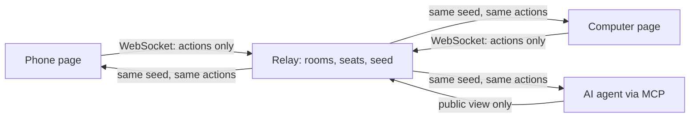

# Pumpkin Killer

**A Flash-era artillery duel, resurrected for the modern browser — phone, computer, and AI agents at one table.** Up to three heroes per side throw across a haunted fence while wind and weather shift every shot. Built for **Kiroween 2026 (Resurrection)** with Kiro specs, hooks, steering, custom agents, and a standard MCP server (`.kiro/`).

Inspired by Flash-era artillery games. Every picture, name, and sound is included under the owner's legal provenance statement; full third-party licences and generation disclosures are in `CREDITS.md` and `docs/ASSET_PROVENANCE.md`.

## How it fits together

Every device runs the same rules from the same seed, so the relay only passes actions along and nobody has to trust anybody's screen. Full architecture, flows and the Kiro workflow: `docs/ARCHITECTURE_FULL_20261124.md`.

## Play

- **On a computer**: `python3 -B scripts/dev_server.py 8080 --with-relay`, then open `http://127.0.0.1:8080/`. The flag starts the room relay, which needs the `websockets` package (`pip install -r requirements.txt`); without the flag everything works except Create room.
- **On a phone**: open the hosted address from the Devpost page in landscape (16:9 works best) and, if the browser offers it, install it to the home screen for full screen.
- **Team size**: pick 1 v 1, 2 v 2 or 3 v 3 on the start screen; each unit has its own hero, HP, turn and ultimate.
- **Against a friend**: press *Create room*. The relay issues a random 6-character code (no look-alike letters), a link and a QR code. Your friend opens the link or scans the code in any browser: nothing to download or install. Whoever sits on the right seat sees the game from their own point of view (you are always on the left, facing right).
- **With your own agent**: on the start screen set a seat to **Agent (MCP)**. The screen shows the room code, a QR code and the command to run on your agent's machine (`python3 -B scripts/make_agent_join_config.py`, walkthrough in `docs/HOST_AGENT_HOWTO.md`). The agent runs on your own machine with your own model account, so the game server never calls a model and the game costs the host nothing. An MCP client can join an existing room as a whole team or claim a subset of units (`join_room(..., claim=1..units)` or `python3 -B scripts/mcp_stdio_server.py --connect <relay> --code <code>`). It plays by the same rules and sees only what a player sees, through seven game tools (`get_public_state`, `get_roster`, `get_history`, `submit_action`, `end_turn`, `set_notes`, `get_notes`) and three room tools (`join_room`, `leave_room`, `wait_for_turn`). A human opens the room and starts the match. In a single-player match an empty seat is played by the built-in computer opponent (Easy, Normal, Hard, or "Smart (online)" when the server has a model configured); in a multiplayer room the host can click **Fill open slots (AI)** right in the lobby (runs in the host's browser at zero server cost) or fill seats from the terminal with `python3 -B scripts/fill_room.py`.

How a turn works: choose a skill or item, set the angle (25 to 80 degrees), hold to charge the power meter, release to throw. Read the wind before you aim. Move once with a die roll instead of throwing, use your one-use skills, and fill the ultimate meter with direct hits. A coin toss decides who goes first. Eight heroes (Skeleton Spearman, Pumpkin Wizard, Bat-cat Assassin, Necromancer, Silver Cross Sister, Ghost Bride, Bell Tower Hunchback, Heavy Pumpkin Guard), each with its own throw, statuses and built ultimate; four battlefields; clear, rain, storm, snow and fog.

## Checked, not just claimed

| What | Result | Where |
|---|---|---|
| Hit judging with the fence down, powers up to the maximum | 425,861 flight steps, 0 false hits, 0 missed hits (14.7 percent of the steps are area or returning weapons, exempt from the false-hit check) | `docs/hit_coverage_20261119.svg` |
| Page flights against the engine, both directions, wind and weather | 67,456 shots each way, 0 mismatches | `docs/rear_rear_weather_wind_20261119.json` |
| Team engine simulation | 6,667 matches at each of 1, 2 and 3 units per side, 20 rule checks, 0 failures | `redteam/evidence/sim_team_full_run2_20261122_summary.txt` |
| Computer opponent levels (hits per throw) | easy 0.141, normal 0.332, hard 0.462 | `node scripts/test_page_ai_hit_rates.js` |
| All tests | 184 `test_*` scripts (+ `sim_team_headless.py`). Full suite (`zsh scripts/run_full_suite.sh`) runs with 0 failures: 178 run, 6 need local sockets and are skipped there (fill-room self-test, MCP stdio, phone room, late join, reconnect, seat grace); those 6, plus the relay, MCP claim, MCP risk and deploy-check suites, were run by hand and pass | `redteam/evidence/recheck_full_suite_v3_20261125.txt`, `redteam/evidence/recheck_socket_v3_20261125.txt` |
| Deployed container | built and run locally: page, relay, MCP and health checks answer; a match runs through nginx, a late join into a started room is refused, a foreign origin is blocked | `redteam/evidence/prepush_docker_e2e_20261124.txt` |

## What is inside

| Part | Where |
|---|---|
| The game page (canvas, one `index.html` plus `js/` and `css/`) | `index.html`, `js/`, `css/` |
| Shared rules every device and the engine agree on: seeded start positions, wind, dice, coin toss, round hash over every unit, golden vectors | `js/determinism.js`, `scripts/determinism_py.py`, `shared/determinism_golden.json` |
| Room relay (random codes, ordered messages, reconnect, team rooms) | `scripts/pk_relay.py`, `js/relay_client.js`, `docs/relay_protocol_20261115.md` |
| Python rule engine and the MCP server (seven game tools and three room tools, public information only; an HTTP `/mcp` endpoint for remote agents) | `scripts/mcp_game_server.py`, `scripts/mcp_stdio_server.py`, `docs/mcp_agent_protocol.md` |
| Balance simulators and property tests | `scripts/sim_balance.js`, `scripts/sim_team_headless.py`, `scripts/test_properties.js` |
| Smart opponent gateway (optional, server side, one cheap model, daily and money caps; the browser never sees a key) | `scripts/pk_ai_gateway.py`, `shared/ai_models.json` |
| Deployment files | `deploy/` |

Run every test: `for t in scripts/test_*.js; do node $t; done` and `for t in scripts/test_*.py; do python3 -B $t; done` (the relay, MCP connection and smoke tests open local sockets).

## Built with Kiro

The whole `.kiro/` folder is committed: specs (`.kiro/specs/`), steering (`.kiro/steering/`), hooks (`.kiro/hooks/`), custom agents (`.kiro/agents/`), a power and an MCP configuration. Kiro CLI wrote the Python engine, the first relay and MCP server, and many early tests from structured task briefs (`docs/kiro_task_*.md` and `docs/kiro_*_result*.md`), first through `kiro-cli chat` and later through the Agent Client Protocol. Additional AI coding assistants handled page wiring, integration, and later features under the owner's direction, and the owner decided every rule. Every Kiro result was re-run before it counted (`docs/kiro_verified.json`, 38 recorded verdicts). Kiro Crew ran a read-only documentation audit (`docs/crew_audit_usage_doc_result.md`). The honest account of what each Kiro feature did, and what did not work, is `docs/KIRO_USAGE_20261116.md`; `JUDGES.md` is the index for reviewers.

## Licence

MIT, see `LICENSE`. Third-party credits, audio sources and the provenance of the generated pictures are in `CREDITS.md` and `docs/ASSET_PROVENANCE.md`.
