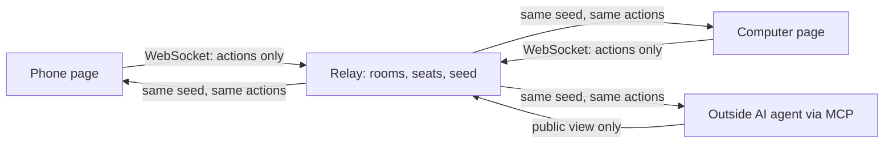
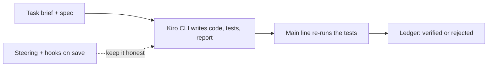
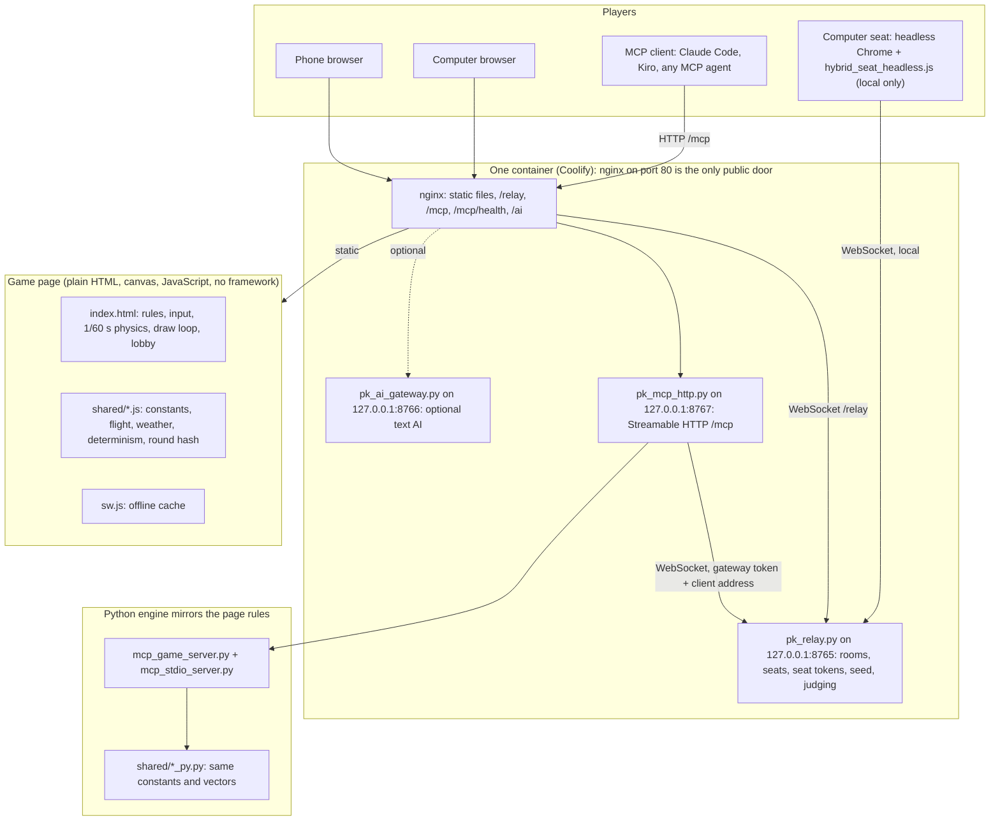
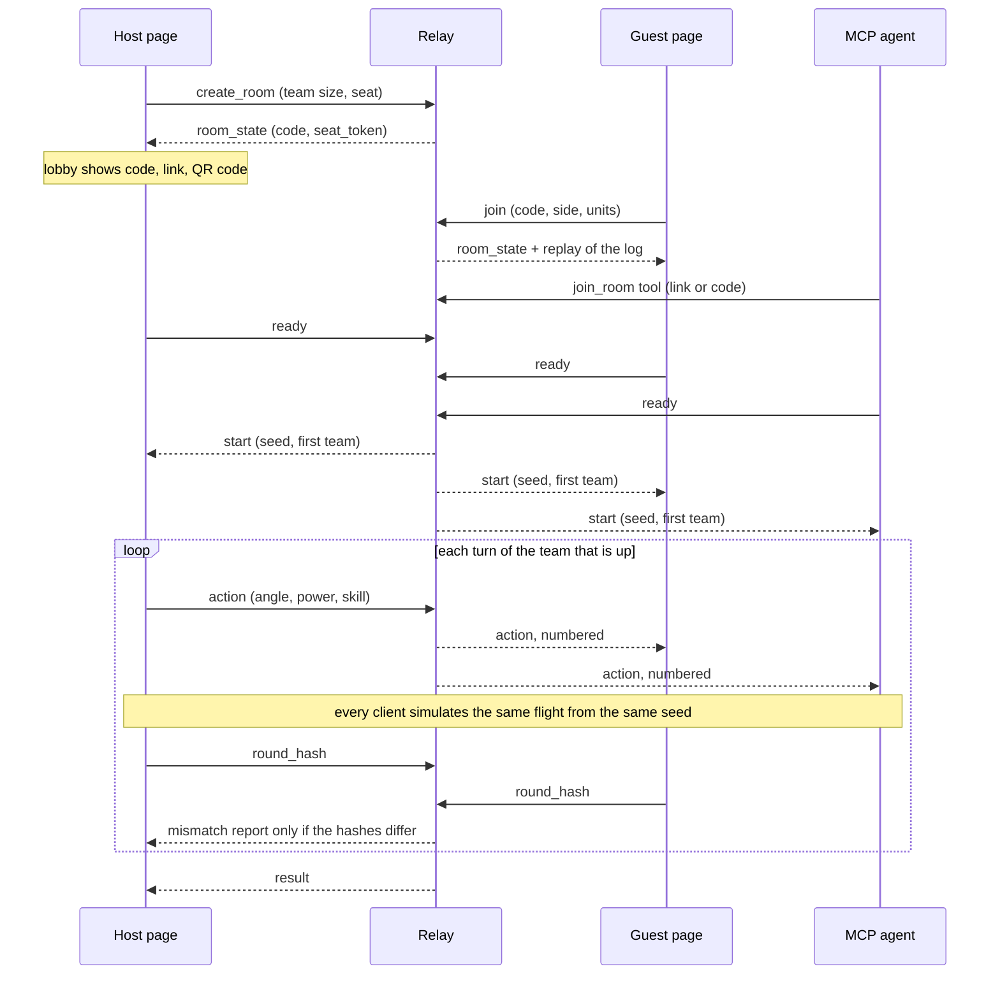
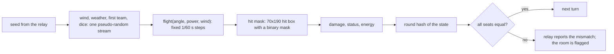
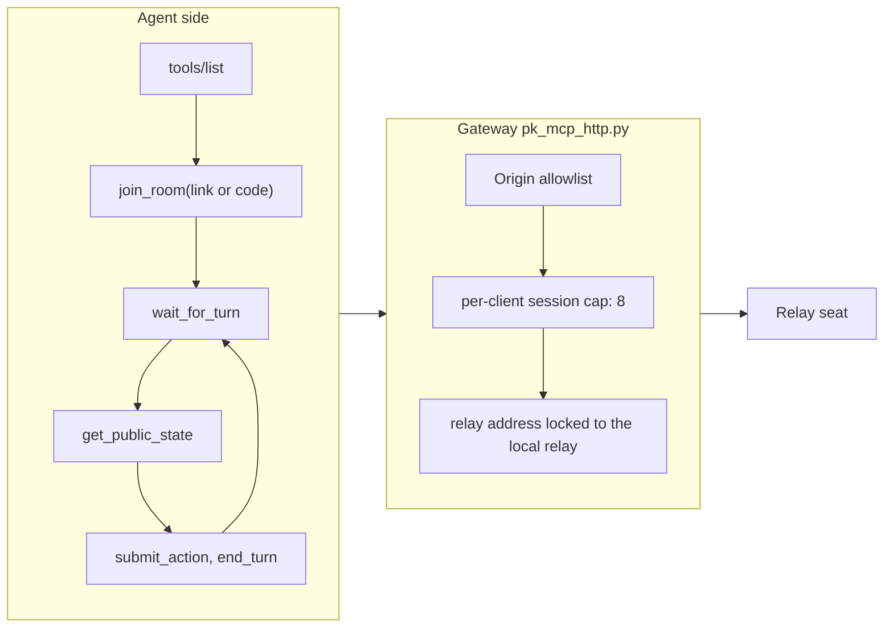
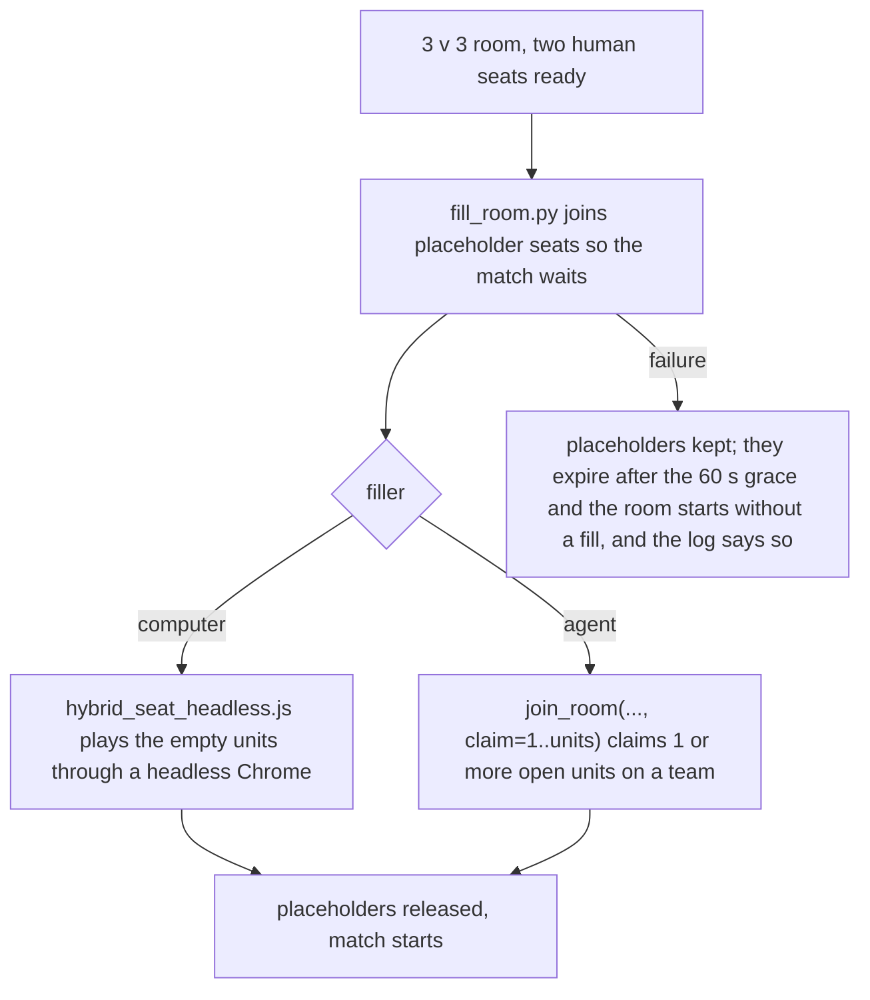
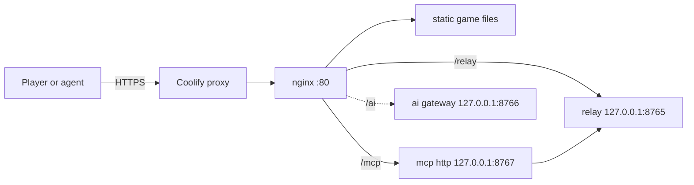
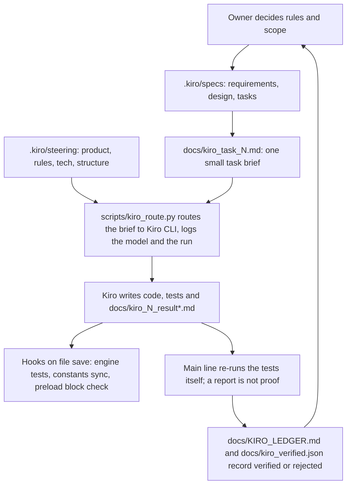

# Pumpkin Killer: architecture, flows, technical details, and how Kiro was used

Written 2026-11-24 from the files and the code in this repository. Every number below was counted on that day with the command shown beside it or is dated where it was counted earlier. Where something is planned, partial, or untested it is marked **NOT DONE**, **PARTLY**, or **NOT VERIFIED**; nothing here is a claim that a feature works unless a test or a log named in the text shows it.

Older companion documents: `docs/architecture.md` (a read-only drawing of the page, from Kiro task 41), `docs/KIRO_USAGE_20261116.md` (the Kiro evidence record), `docs/relay_protocol_20261115.md`, `docs/mcp_agent_protocol.md`, `docs/ADR_unit_slot_fill_20261124.md`.

## 0. The opening card (the first seconds of the demo video)

Two strips fit in the first 8 seconds of the video and on the top of the README. Left: how a match is wired. Right: what Kiro did.

One sentence for the narration: *every device runs the same rules from the same seed, so the relay only passes actions along and nobody has to trust anybody's screen.*

## 1. System architecture

| Part | File | What it does | State |
|---|---|---|---|
| Game page | `index.html`, `js/`, `css/`, `shared/` | Whole game on a 1920x1080 canvas; fixed 1/60 s physics; full-screen Lobby (`js/lobby_model.js`) | built, tested, live |
| Relay | `scripts/pk_relay.py` | Creates rooms with a random 6-character code, assigns seats and one-use invite tickets, sends the same seed, forwards only allowlisted actions (1 unit per team turn), checks size (16 KiB), rate (10 msgs/s), seat and phase | built, tested, live |
| MCP stdio bridge | `scripts/mcp_stdio_server.py` | 7 game tools and 4 room tools (`join_room`, `lock_hero`, `leave_room`, `wait_for_turn`) + **`PageJudgeRelay`** (`scripts/page_judge_seat.js` running `index.html` on Node.js 22) | built, tested with real pages |
| MCP over HTTP | `scripts/pk_mcp_http.py` | The same 11 tools + `PageJudgeRelay` at `/mcp` (`PK_MCP_PAGE_JUDGE=on`, the only path since 2026-11-27; `PK_MCP_MAX_PAGE_JUDGES=10`) for remote agents; Origin allowlist, locked to the local relay, per-client session cap | built, tested, live (`https://pumpkin.jace0423.com/mcp`) |
| Computer seat | `scripts/hybrid_seat_core.js`, `scripts/fill_room.py`, `scripts/run_slot_room.py`, `scripts/host_room.py`, `#lobby-allow-ai` | With **Computer fills open places** ticked in the lobby, host **Start** fills open places in the host's browser (zero server cost); headless scripts also work from CLI | built, tested |
| AI gateway | `scripts/pk_ai_gateway.py` | Optional text generation backend | built; copied into image |
| Deploy | `deploy/Dockerfile.coolify`, `deploy/entrypoint.sh`, `deploy/nginx.conf` | One container: `python:3.12-alpine` + `nginx` + `nodejs` (for `PageJudgeRelay`) | built, deployed (`pk-release-kiroween-20261125-v3`) |

State lives in memory: restarting the container ends every room.

## 2. A match from room to result

- **Invite**: the lobby shows the 6-char code, shareable link, and QR code. Standard lobby links carry `room=CODE&team=N&lobby=1` (legacy `?room=CODE` links keep the legacy panel). An invited MCP agent receives a one-use ticket `?room=CODE&team=N&lobby=1&invite=<ticket>`.
- **Started room**: a new red or white seat in a room whose match has started is refused with `room_started` (2026-11-24, `scripts/test_relay_late_join.py`, `scripts/test_late_join_page.js`); before that fix the seat was created and the page stayed silent. Spectators and a `resume` of an existing seat are unchanged.
- **Reconnect**: each seat has a secret `seat_token`. A dropped connection is held for 60 seconds and `resume` replays the missed numbered messages. After 60 seconds the seat is removed and the other seats are told.
- **Seat leaves**: a seat that leaves a started match makes its team lose (a decision the owner may overturn). A seat whose units are all dead is ignored (red-team R2A-F1).

## 3. Why the relay is thin: determinism and fairness

The page and the Python engine run the same rules from the same inputs, so the relay does not simulate anything and cannot cheat.

Evidence (re-run commands in parentheses): shared constants and golden vectors in `shared/` are read by both the JavaScript and Python tests (`node scripts/test_determinism.js`, `python3 scripts/test_determinism_golden.py`, 66 flight vectors plus 500 cross-runtime cases); hit judging was replayed over 425,861 flight steps with 0 false hits and 0 missed hits, with the stated exemption for area and returning weapons (`docs/hit_coverage_20261119.svg`); 67,456 shots in each direction showed 0 mismatches between the page and the engine (`docs/rear_rear_weather_wind_20261119.json`).

## 4. MCP: how an outside agent sits at the table

- **Tools**: **11 MCP tools** = 7 game tools (`get_public_state`, `get_roster`, `get_history`, `submit_action`, `end_turn`, `set_notes`, `get_notes`) and **4 room tools** (`join_room`, `lock_hero`, `leave_room`, `wait_for_turn`). People open rooms; agents join by code or one-use invite ticket.
- **Public view only**: an agent sees what a player sees. The seed, pending actions, Shield Wall hidden points, and opponent's aim are not in the view (`public_throw()` in `scripts/mcp_stdio_server.py`).
- **Hosted limits**: the gateway reports the real client address to the relay only with a one-time random token (`PK_RELAY_GATEWAY_TOKEN`, made at container start), so the relay's per-address connection cap counts each remote client. Each client may hold 8 `/mcp` sessions (`PK_MCP_MAX_SESSIONS_PER_IP`); the ninth gets HTTP 429.
- **Partial claim & `PageJudgeRelay`**: an agent can claim a whole team or a subset (`join_room(..., claim=1..units)`) or accept a single-slot invite (`invite=` + `lock_hero`). Connected rooms are judged by **`PageJudgeRelay`** (`PK_MCP_PAGE_JUDGE=on`, the only path since 2026-11-27; `scripts/page_judge_seat.js` on Node.js 22), running `index.html` cleanly in a separate VM (~65 MB RSS/process; capped at `PK_MCP_MAX_PAGE_JUDGES=10`).
- **Verified locally**: 2 consecutive mixed 3v3 matches (2 browsers + 2 HTTP `/mcp` `PageJudgeRelay` agents + AI fill) ran to completion with `0 out_of_sync` and rematch via `reset_lobby` (`(not published)`). Hosted V4 real-phone + `/mcp` match verification follows Coolify deploy.

## 5. Filling empty seats (unit slot fill)

State (updated 2026-11-26): works both directly in the full-screen **Lobby** (**Computer fills open places** checkbox `#lobby-allow-ai`, filling open spots in the host's browser on **Start** at zero server cost) and from a terminal (`python3 -B scripts/fill_room.py`, `scripts/run_slot_room.py`). External MCP agents can join via `invite=` + `lock_hero` or `claim=1..units`. Design choices are in `docs/ADR_unit_slot_fill_20261124.md`.

## 6. Deployment

`deploy/entrypoint.sh` starts the Python relay, MCP HTTP gateway (with `PK_MCP_PAGE_JUDGE=on`, the only path since 2026-11-27, `PK_MCP_MAX_PAGE_JUDGES=10`, and Node.js 22 installed), optional AI gateway, and nginx, with a trap for stop signals. Only nginx faces outside. Environment variables in Coolify: `PK_ALLOWED_ORIGINS`, `PK_RELAY_TRUST_PROXY=1`, `PK_RELAY_MAX_PER_ADDR=16`; the gateway token is generated per start. Live at `https://pumpkin.jace0423.com/`.

## 7. How Kiro was used

### 7.1 The loop

### 7.2 Kiro features, used or not (counted 2026-11-24)

| Kiro feature | Used? | Evidence |
|---|---|---|
| CLI | Yes, the main route | `scripts/kiro_route.py`; 195 task briefs `docs/kiro_task_*.md`; 109 result files `docs/kiro_*_result*.md` |
| Specs | Yes | 32 folders in `.kiro/specs/` (requirements, design, tasks) |
| Steering | Yes | 11 files in `.kiro/steering/` (for example `structure.md` makes `index.html` a one-writer file) |
| Custom agents | Defined, one recorded run | 8 files in `.kiro/agents/`; `pk-player` played one recorded match through the public tools (`docs/kiro_162_result_gpt-5.6-terra.md`, not counted as verified); the other agents have definitions only |
| Hooks | Yes | 7 files in `.kiro/hooks/`; `docs/kiro_evidence/raw/hook_runs.log` (git-ignored, so not in a public tree) held 176 save entries on 2026-11-16 |
| MCP | Yes | `.kiro/settings/mcp.json`; `scripts/mcp_stdio_server.py`; one CLI-routed match; the IDE attempt failed |
| Property-based testing | Yes | `scripts/test_properties.js`: six seeded properties; task 179 recorded four failures and task 181 corrected them |
| Powers | One written, not installed | `.kiro/powers/pumpkin-killer-seat/` |
| IDE | Once | one save-triggered hook run, `docs/kiro_evidence/raw/ide_hook_run_20261115.txt` |
| Crew (ACP) | Once, read-only audit | `docs/crew_audit_usage_doc_result.md` |
| Web | No | no record |

### 7.3 Spec-driven versus no spec (a real comparison from this project)

- With a spec and a test: Kiro task 225 wrote an end-to-end test with two MCP seats; it failed and showed a relay that silently skipped one team's turn from round 2; the fix was one function.
- Without a spec: a phone-layout test that pinned strings passed while the hero tiles had disappeared; only measuring the real page found it. Details: `docs/KIRO_USAGE_20261116.md`.

### 7.4 Who did what

- Kiro (CLI, ACP, Crew): task briefs, specs, scripts, tests, the Python engine, the relay and MCP server, result reports. On 2026-11-16, 109 of 333 development commits named a Kiro task (method in `docs/KIRO_USAGE_20261116.md`). Since 11-16, the development repo grew to 514+ commits (115 naming Kiro) as later work (team battles, lobby AI fill, partial-unit MCP `claim`, hosted MCP, red-team fixes, phone layout) was completed by the owner with additional assistants. Note: the public release repository is a privacy-cleaned single-commit snapshot, so all published task briefs and result files are preserved directly in `docs/` and `.kiro/`.
- A second AI coding assistant (Claude Code) under the owner's direction: page wiring, integration, independent verification, fixes.
- Gemini: the hosted MCP server and several red-team fixes on 2026-11-24, re-run by the main line.
- The owner: every rule, every public text, the art pipeline (Qwen-Image-Edit on Colab) and the decisions recorded in `(not published)`.

Rule that kept this honest: **a Kiro result is a report, not verification.** The main line re-runs the tests; `docs/kiro_verified.json` lists only tasks with a recorded verdict.

## 8. Tests and evidence (2026-11-26)

| Item | Result | How to re-run |
|---|---|---|
| Whole suite + sockets | **206 `test_*` scripts (`108 JS + 1 MJS + 97 Python`) + `sim_team_headless.py`**: `run_full_suite.sh` passes (`193 PASS, 0 FAIL, 13 SKIP`); all **13/13** local-socket scripts pass outside sandbox; **14/14** `PageJudgeRelay` unit tests OK | `zsh scripts/run_full_suite.sh`, `python3 -B -m unittest scripts/test_mcp_invite_page.py scripts/test_page_judge_relay.py` |
| Mixed 3v3 E2E (2 matches) | 2 headless browsers + 2 HTTP `/mcp` `PageJudgeRelay` agents + AI fill across lobby rematch: `0 out_of_sync` | `PK_PAGE_JUDGE=on zsh redteam/live_mix_20261126/run_local.sh` |
| Room late join | relay 4 tests, page 17 checks, real Chrome 1 test; each failed before the fix | `python3 -B scripts/test_relay_late_join.py`, `node scripts/test_room_status.js`, `node scripts/test_late_join_page.js` |
| Phone landscape invite panel | 10 viewport sizes pass hit-testing | `node scripts/test_invite_panel_fit.js` |
| MCP risk A and B | 10 tests | `python3 -B scripts/test_mcp_risk_ab.py` |

## 9. Known limits and open items

| Item | State |
|---|---|
| Hosted URL (`https://pumpkin.jace0423.com/`), `/relay`, `/mcp/health` | LIVE; deploying updated `PageJudgeRelay` + `nodejs` container (`LIVE-3V3-4`), then V4 live verification |
| Lobby computer fill (`#lobby-allow-ai`) | DONE: fills empty seats in the host's browser on **Start** (zero server cost); verified E2E in 1v1, 2v2, and 3v3 |
| AI (MCP) fill of part of a team | DONE (2026-11-25): `join_room(..., claim=1..units)` allows an MCP agent to claim 1 or more units on a shared team with 3-way `round_hash` parity (`scripts/test_mcp_claim.py`) |
| Container image | Fixed 2026-11-24 and checked in a real container: the AI gateway is copied, the nginx `types` block that real nginx rejected is repaired, a watcher stops the container if the relay or MCP process dies (`scripts/check_coolify_deploy.py`, `redteam/evidence/prepush_docker_*_20261124.txt`). Still open: the `/ai` origin check, `PK_RELAY_TRUST_PROXY`, the Coolify variables only the owner can set. Details: `(not published)` |
| Room state | in memory; a restart ends every room; one container, no horizontal scaling |
| Match where a seat leaves | that team loses (owner may overturn) |
| Portrait phone | a rotate hint covers the page by design |
| Real phone in full screen exit | an overflow was reported once and not reproduced (gap G3) |

## 10. Where to find things

| Question | Open |
|---|---|
| What are the rules and the engine? | `index.html`, `shared/`, `scripts/mcp_game_server.py` |
| How do rooms work on the wire? | `docs/relay_protocol_20261115.md`, `scripts/pk_relay.py` |
| How does an agent play? | `docs/mcp_agent_protocol.md`, `scripts/mcp_stdio_server.py` |
| How was Kiro used? | `docs/KIRO_USAGE_20261116.md`, `docs/KIRO_LEDGER.md`, `.kiro/` |
| What was found and fixed in red-team rounds? | `(not published)` |
| What is checked before publishing? | `scripts/release/README_gate.md`, `(not published)` |
