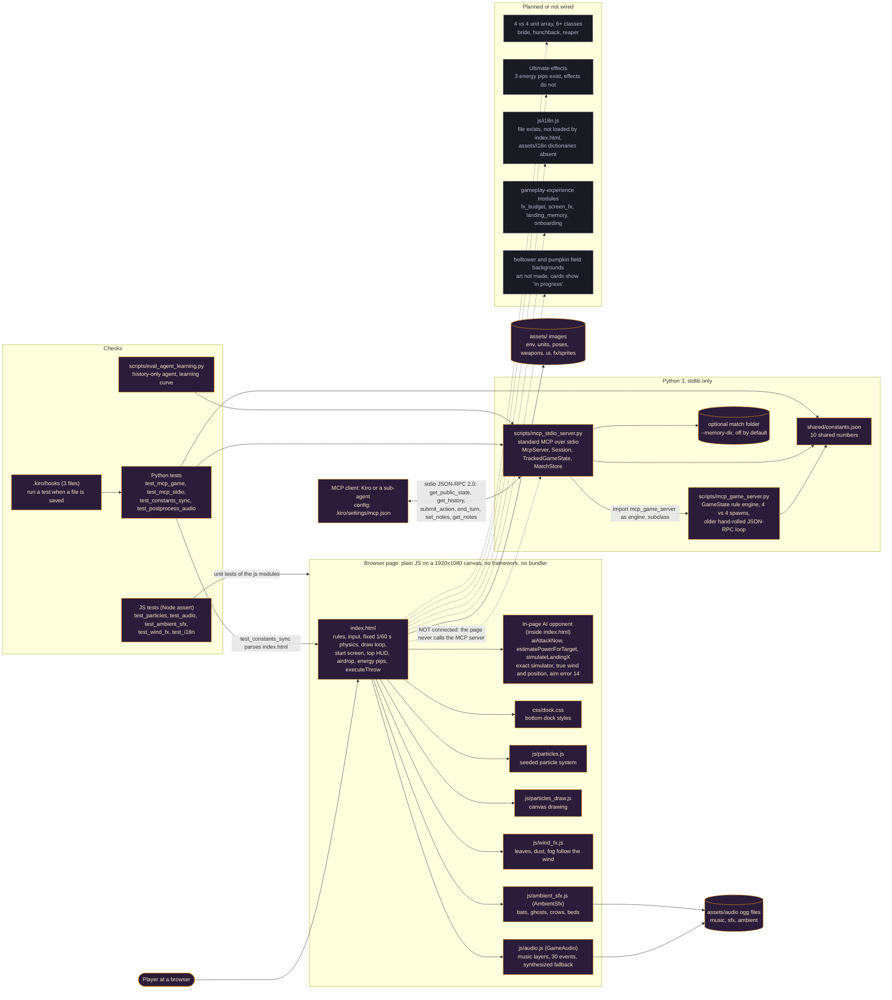
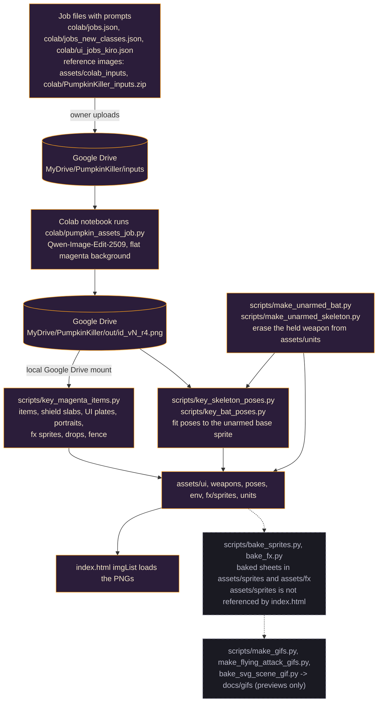
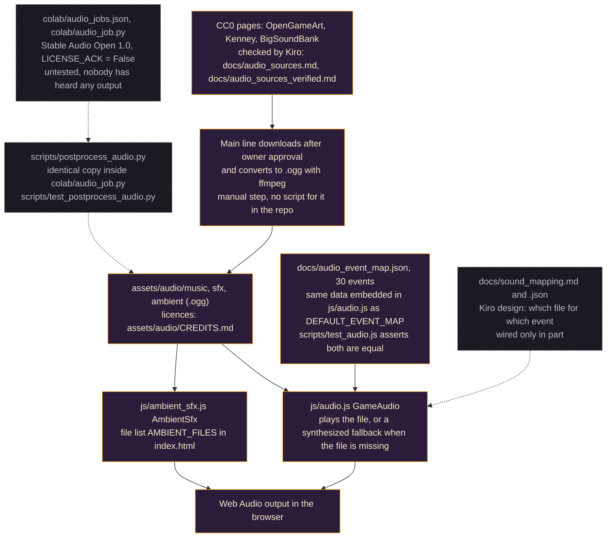

# Architecture (Kiro task 41)

Drawn from the files in this checkout, read in this session. Nothing here was run: no game, no test, no Mermaid renderer.
Line numbers in `index.html` are from the read and will shift.

Legend: **solid** line or box = exists in the repo and is used. **dashed** = planned, not built, not wired, or deliberately not connected.
The same content is drawn as `docs/architecture.svg`.

## (a) Runtime architecture

Reading the diagram:

- The playable game and the MCP server are two separate programs. They share only `shared/constants.json`, and only ten numbers of it are checked by a test.
- The opponent in the page is the box `AI` (code in `index.html`). It exists and is used, but it is not an MCP client. The dashed edge from `index.html` to the MCP server marks the missing connection.
- The MCP server serves public state only. The server file `mcp_stdio_server.py` overrides the engine's built-in AI so it returns nothing: agents act only through tools.

## (b) Asset pipelines

### Art: Colab makes all final art, never Kiro, never code

### Audio: CC0 files plus code-made sounds

## (c) Every box and where to open it

Status: **built** = file exists and is used by the game or a test. **partly** = file exists, only part is wired. **planned** = not in the repo or not used.

### Runtime

| Box | Path | Status | What to look at |
|---|---|---|---|
| Game page | `index.html` | built | `imgList` (line 408), `ensureGameAudio` (287), `startMatch` (362), `executeThrow` (885), `resolveRound` (1229), `scheduleAirdrop` (1333), `updatePhysics` (1437), `draw` (1694), `drawTopHUD` (2420), `loop` (2636) |
| In-page AI opponent | `index.html` | built, not MCP | `simulateLandingX` (1140), `estimatePowerForTarget` (1150 area), `aiAttackNow` (1169), `triggerAITurn` (1190), `AI_AIM_ERROR = 14` (521) |
| Energy pips and ultimate arm toggle | `index.html` | partly | `energy`, `ultUsed`, `toggleUltimate` (511 to 519). The comment at line 510 says the ultimate effects are not built |
| Dock styles | `css/dock.css` | built | linked at `index.html` line 7 |
| Particle system | `js/particles.js` | built | `Particles.createSystem` used at `index.html` line 612 |
| Particle drawing | `js/particles_draw.js` | built | `drawParticles(ctx, fxSys.particles)` at line 1756 |
| Wind scene effect | `js/wind_fx.js` | built | `WindFx.createWindField` (508), `windField.update` (1438), `windField.draw` (1710) |
| Game audio | `js/audio.js` | built | `GameAudio.createAudio` in `ensureGameAudio` (287) |
| Ambient creature sounds | `js/ambient_sfx.js` | built | `AmbientSfx.createAmbient` (same function), `AMBIENT_FILES` (299) |
| Images | `assets/env`, `units`, `poses`, `weapons`, `ui`, `fx/sprites` | built | `imgList` in `index.html`; origin per folder in `docs/ASSET_PROVENANCE.md` |
| Sound files | `assets/audio/music`, `sfx`, `ambient`, `CREDITS.md` | built | 7 music, 26 sfx, 13 ambient files listed on disk |
| Shared numbers | `shared/constants.json` | built | 10 keys: GROUND_Y, GRAVITY, V0_PER_POWER, FENCE_X, FENCE_W, FENCE_H, WIND_MIN, WIND_MAX, THROW_ANGLE_DEFAULT, TURN_SECONDS |
| Rule engine | `scripts/mcp_game_server.py` | built | `GameState`, `handle_mcp_request` (older loop, not the standard MCP handshake) |
| Standard MCP server | `scripts/mcp_stdio_server.py` | built | `TrackedGameState` (111), `MatchStore` (214), `Session` (280), `McpServer` |
| Match folder | path chosen by `--memory-dir` or `PK_MEMORY_DIR` | built, off by default | `(not published)` |
| MCP client config | `.kiro/settings/mcp.json` | built | server name `pumpkin-killer`, auto-approves the three read tools |
| MCP tool protocol | `docs/mcp_agent_protocol.md` | built | six tools, fairness rules |

### Checks

| Box | Path | Status |
|---|---|---|
| JS tests | `scripts/test_particles.js`, `test_audio.js`, `test_ambient_sfx.js`, `test_wind_fx.js`, `test_i18n.js` | built (5 files) |
| Python tests | `scripts/test_mcp_game.py`, `test_mcp_stdio.py`, `test_constants_sync.py`, `test_postprocess_audio.py` | built (4 files) |
| Learning curve check | `scripts/eval_agent_learning.py` | built, not named `test_*` |
| Wind table check | `scripts/verify_wind_table.py` | built; it recomputes a wind table and writes `docs/wind_test_record.md`, it is not a test runner |
| Hooks | `(not published)`, `test-constants-sync-on-save.kiro.hook`, `test-rig-on-save.kiro.hook` | the first two run; the third is a no-op (its inputs do not exist) |

### Art pipeline

| Box | Path | Status |
|---|---|---|
| Job files | `colab/jobs.json`, `colab/jobs_new_classes.json`, `colab/ui_jobs_kiro.json` | built |
| Reference images | `(not published)`, `(not published)` | built |
| Colab job | `colab/pumpkin_assets_job.py` (Qwen-Image-Edit-2509) | built, see the note on `TAG` in section (d) |
| Drive folders | `MyDrive/PumpkinKiller/inputs` and `/out` | outside the repo; `DEFAULT_OUT` in the key scripts points at a local Google Drive mount |
| Keyers | `scripts/key_magenta_items.py`, `key_skeleton_poses.py`, `key_bat_poses.py` | built |
| Unarmed variants | `scripts/make_unarmed_bat.py`, `make_unarmed_skeleton.py` | built (bat and skeleton only) |
| Bakers | `scripts/bake_sprites.py`, `scripts/bake_fx.py` | built; `assets/sprites/` is not loaded by `index.html` |
| Preview gifs | `scripts/make_gifs.py`, `make_flying_attack_gifs.py`, `bake_svg_scene_gif.py` | built, previews in `docs/gifs/` only |
| Style rules | `docs/art_style_guide.md`, `docs/asset_mapping_table.md` | built (documents) |

### Audio pipeline

| Box | Path | Status |
|---|---|---|
| Source checks | `docs/audio_sources.md`, `docs/audio_sources_verified.md`, `docs/halloween_music_candidates.md` | built (documents) |
| Credits | `assets/audio/CREDITS.md` | built |
| Event map | `docs/audio_event_map.json` and `DEFAULT_EVENT_MAP` in `js/audio.js` | built, kept equal by `test_audio.js` |
| Sound design | `docs/sound_design.md`, `docs/sound_mapping.md`, `docs/sound_mapping.json` | partly wired |
| Generated audio | `colab/audio_jobs.json`, `colab/audio_job.py`, `scripts/postprocess_audio.py` | planned: never run, licence acknowledgement is off |

### Planned or not wired

| Box | Path | Status |
|---|---|---|
| Language switch | `js/i18n.js`, `scripts/test_i18n.js` | partly: both exist, `index.html` does not load `i18n.js`, and `assets/i18n/*.json` is not in this checkout |
| Layered rig | `(not published)`, `(not published)`, `(not published)` | planned: none exist; the spec `.kiro/specs/layered-rig` marks them done |
| Pure physics module | `(not published)`, `(not published)` | planned in this checkout: neither exists; the spec `.kiro/specs/physics-pbt` marks them done |
| Gameplay-experience modules | `(not published)`, `screen_fx.js`, `landing_memory.js`, `onboarding.js` | planned: the spec tasks are unchecked, no file exists |
| 4 vs 4 and new classes | `colab/jobs_new_classes.json` (art prompts), `COMING_HEROES` in `index.html` (grey cards) | planned |
| Extra scenes | `SCENES` in `index.html` lists belltower and pumpkin field | planned: `assets/env/bg_belltower.png` and `bg_pumpkin_field.png` do not exist |
| Ultimate effects | designs in `docs/ultimates_design.md`, `docs/ultimate_rules.md`, `docs/ultimate_mapping.md` | planned |

## (d) What is NOT connected or NOT built

1. **The page does not call the MCP server.** `index.html` has no MCP call; its only `fetch(` loads audio files. The product steering says humans and sub-agents both act through MCP. That is true for the Python engine and its tests, not for the playable page.
2. **The in-page AI is an exact simulator.** `aiAttackNow` bisects power with `simulateLandingX`, using the true wind and the player's true position, then adds a random error of up to 14 power units. `.kiro/steering/product.md` says the AI has no trajectory simulator. `(not published)` item B6 and `docs/review_reconcile.md` item C23 leave this to the owner. The MCP side has no simulator tool.
3. **Wind differs between page and server.** Page: acceleration, `WIND_ACCEL = 72` (line 520). Server: constant push, `WIND_PUSH = 67.5` in `mcp_stdio_server.py` and `67.5` in `mcp_game_server.py` line 329. `test_constants_sync.py` checks ten keys and does not include this. `.kiro/steering/tech.md` still says 48 and 45, so the steering table is out of date. Per `tech.md` the drift is reported, not fixed.
4. **Other numbers that differ between page and server** (not covered by the sync test): damage per class (engine 16 / 26 / 18 / 20 for bat / wizard / skeleton / knight, page 20 / 28 / 24 / 30), and the engine's own fill-in AI formula.
5. **The page is 1 vs 1; the engine has 4 + 4 spawn slots.** 4 vs 4 in the page is not built.
6. **Defend flow differs.** The page drags the shield with a counter of 4. The MCP server takes `path1` and `path2` but enforces only `path1` (`.kiro/steering/rules.md`, task 10a of the `mcp-standard` spec).
7. **Art that is referenced but missing on disk:** `assets/units/unit_knight_unarmed.png`, `assets/env/drop_parachute.png`, `assets/ui/portrait_skeleton.png`, `portrait_bat.png`, `portrait_knight.png` (only `portrait_wizard.png` exists), `bg_belltower.png`, `bg_pumpkin_field.png`. The page tolerates missing files.
8. **Art on disk but not used by the page:** `assets/ui/dock_frame.png`, `plate_normal.png`, `plate_active.png`, `lock_plate.png`, `assets/env/fence_black_intact.png` (the fence is still drawn in code), and all of `assets/sprites/`.
9. **Sound files missing, synthesized instead:** `move_step.ogg`, `item_pickup.ogg`, `ultimate_ready_chime.ogg` are named by the event map and are not in `assets/audio/sfx/`. Nobody on the project has heard any sound (`(not published)` item D3).
10. **New classes (bride, hunchback, reaper) and ultimate effects** have designs and Colab prompts, no art and no code.
11. **Hooks:** `test-rig-on-save` does nothing because its inputs do not exist. `test-constants-sync-on-save` still says in its description that `test_constants_sync.py` does not exist; it does. No hook runs `test_mcp_stdio.py`, `test_audio.js` or `test_particles.js` (task 5 of the `judging-fit` spec is unchecked).
12. **`scripts/aws_search_replace.py`, `scripts/aws_erase_object.py`:** one-off Bedrock calls. They are in neither pipeline above. The repo does not record whether any shipped asset came from them, and `(not published)` says no paid APIs.
13. **Browser behaviour is untested.** There is no test for `index.html` itself. The hook that fires when `index.html` is saved runs the Python engine test, which does not load the page.

## Could not verify

- That the SVG and the Mermaid blocks render: no renderer was available.
- `colab/pumpkin_assets_job.py` uses a variable `TAG` in the output file name and never defines it in the file. The files on Drive end in `_r4` (see `JOBS` in `key_magenta_items.py`), so the notebook probably defines it. How `jobs_new_classes.json` and `ui_jobs_kiro.json` are given to a script that reads only `inputs/jobs.json` is not recorded.
- Whether any test passes today. No test was run.
- Spec checkboxes can be stale: the `particles` spec still lists "wire into index.html" as open, while `index.html` already uses the system.
