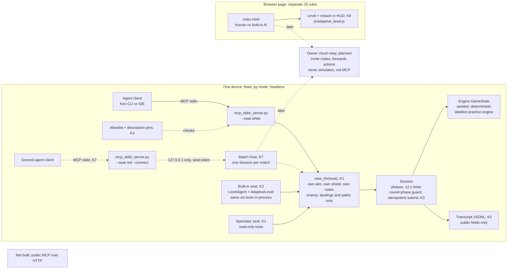

# MCP architecture review (Kiro task 144, claude-opus-5.5, 2026-11-15)

Team-size update (2026-11-16): the engine formerly accepted 4 units per side; supported sizes are now 1, 2, and 3.

Marks: `[file:line]` seen this session; `[file symbol()]` seen, line not pinned; `[inference]` my reasoning. Bare `:NNN` means `(not published)`. `<A>` and `<B>` stand for the two filename prefixes of the local reference projects in `(not published)` (git-ignored). Grep does not search that folder, so long files there are cited by section. No command was run (section 7).

## 1. What the framework is today
- One process holds one match. `main()` builds one `Session` and serves stdio; nothing outlives the process [:796-806, :277].
- Protocol: newline JSON-RPC 2.0 with initialize, ping, tools/list, tools/call; notifications get no reply; versions up to 2025-06-18 [:45, :699-769].
- Layers: `McpServer` (protocol) → `Session` (phases, per-turn bookkeeping, timer, notes) → `TrackedGameState` (engine subclass: engine AI off, per-throw wind and sampled path) → `GameState` rules [:108-152, :116-118].
- Tools: get_public_state, get_history, get_notes (readOnlyHint); submit_action, end_turn, set_notes. `submit_action` now accepts throw, move, defend, each one-use side skill (`heal`, `double`, `heavy`), and the eight hero ultimates. Public state includes remaining side skills and ultimate energy; Shield Wall coordinates are visible only to the owning seat.
- Who can call what: every connected client can call every tool. The only gate is the phase: phase `human` accepts any `human` unit, phase `agent` any `subagent` unit [:449-452]. `end_turn` without `phase` ends whichever phase is current [:535-553].
- Seats: none. Controller is per unit, `human` or `subagent`; there is no `builtin` kind [scripts/mcp_game_server.py:115-124].
- Modes: `human_vs_agent` (red human, white subagent); `agent_vs_agent` (all 6 subagents, the match starts in phase `agent`); `random_assignment` (the 6 controllers shuffled across both teams) [mcp_game_server.py:115-124].
- Public: positions, hp, class, controller, `acted`, `moved`, wind, wall, both teams' shields with `path_ids`, both teams' remembered enemy paths, ultimates, last timeout [:373-405]. History: landing, hit, damage, wind at throw, path every 6th step; human aim removed, agent aim shown to every caller [:155-164].
- Hidden: seed, dice, pending actions [:285; test_mcp_stdio.py test_no_hidden_values_in_state()]. The engine's own `landing_history` holds human aim; the server rebuilds state without it [mcp_game_server.py:211].
- State lives in memory. Optional `--memory-dir` writes public history, notes and result per match and appends `index.jsonl` across matches [:211-273, :802].
- Timer: agent phase 12 s, checked lazily at the next tool call; the human phase has no timer [:342-347, :408-413; test_mcp_stdio.py test_timeout_does_not_fire_before_deadline_or_in_human_phase()].
- Headless today: `eval_agent_learning.py` drives `McpServer.handle_message` in-process, ends the human phase itself and plays a fixed-target fixture [scripts/eval_agent_learning.py play_seed()]; `pk_mcp_health.py` spawns the configured command and stops after one get_public_state [scripts/pk_mcp_health.py run()]; `agent_levels.py` wraps the learner in easy/normal/hard knobs behind a six-tool client [scripts/agent_levels.py PublicToolClient]. No runner plays a full match to a winner.
- Shipped config stalls: mcp.json passes no `--mode`, so Kiro gets `human_vs_agent` [mcp.json:5; :798]. The human phase has no timer, and the protocol and `instructions` tell the agent never to end it [docs/mcp_agent_protocol.md:37; :735-737]. A lone Kiro client therefore waits at round 1 [inference].
- Earlier plan check (`(not published)`): "23 stdio tests" is now 27 (I counted 13 protocol and 14 session `test_` functions); F1 now exists as `pk_mcp_health.py`; its duel step relies on the kiro_75 shared host, which owner decision 10 re-reads as a thin per-device channel [docs/owner_decisions_20261110_agents_headless.md:17]. kiro_75 §1.4 item 6 (random re-placement, wall 20) is stale [scripts/test_mcp_game.py test_wall_loses_8_per_hit(), test_unmoved_units_keep_x_across_rounds()]; the fixture docstring in `eval_agent_learning.py` repeats the stale claim.
- Verdict: right shape for the owner's fixed .py mode (decision 11c): the engine is the authority on its device, MCP is the channel, physics is untouched [owner_decisions:17-18]. Not yet multiplayer: no seat, one client per process, and views that break decision 5 and Q4 [owner_decisions:7, :12] [inference].

## 2. Is it multiplayer-safe? Holes and smallest fixes
| # | Hole | Evidence | Smallest fix |
|---|---|---|---|
| H1 | No seat identity. Any client submits for any unit of the phase's controller kind and can end either phase, so an agent can play the human's units. | :449-452, :535-553 | `--seat` (red, white, spectator or referee) on the process; tools act only for that seat's units (K1). In stdio the process is the identity, so no token is needed until K7. |
| H2 | Two agents cannot share a match: each client spawns its own process and its own Session. | :796-806 | Built-in seat in-process for demos (K2); loopback host plus `--connect` proxy for two real clients (K7). |
| H3 | Turn ownership is by controller kind, not team. In `agent_vs_agent` all 6 units act in one phase; resolution runs red_1..white_3 in order and skips dead units, so red can kill a white unit before it throws. | mcp_game_server.py:313-322 | Owner decision (rules): alternate the first team per round, or land every throw before applying damage. Report only. |
| H4 | `end_turn` replay: `round` and `phase` are optional, so a retry after a lost reply ends the next phase. | :535-544 | Require both for every seat except referee (K3). |
| H5 | `submit_action` replay: an identical retry returns isError "already submitted"; state is safe but the client cannot tell success from failure. | :463-467 | Identical args in the same round return the stored result with `duplicate: true` (K3). Same pattern as a stored replay result in `<A>_README.md:38`. |
| H6 | Timeouts are lazy; if no client calls, nothing advances. The human phase never times out, unlike the 12 s rule and Q3. | :342-347, owner_decisions:11 | Keep lazy ticks (fine headless); add `--human-turn-seconds` (default off until the owner decides) (K3). |
| H7 | No spectator: the only view is the referee view with every team's fields. | :373-405 | `spectator` seat = fields public to both teams (K1). |
| H8 | Notes are one string for every caller: opponents read and overwrite each other's lessons. | :288, :555-573 | Notes per seat (K1); labelled as untrusted data (K5). |
| H9 | 3 v 3 later: a seat should own a unit list, not a team, or 3 v 3 needs new code. | engine spawns 3 per team [mcp_game_server.py DEFAULT_RED_HEROES] | Define a seat as `{seat_id, team, units[], kind}` now (K1). B19 stays frozen. |
| H10 | The engine file still has a non-standard JSON-RPC loop with `set_match_mode` (chosen seed) and `resolve_round`. Only reachable if someone configures that file as the server. | mcp_game_server.py:455-490 | Pin the configured command in the allowlist test (K4). |

## 3. What to borrow from the local reference projects
| Pattern | Where | How it maps to our tools | Cost |
|---|---|---|---|
| Listener on loopback only; never expose through a tunnel | `<A>_THREAT_MODEL.md:8, :30`; `<A>_README.md:20, :48` | K7 host binds 127.0.0.1; no hosted MCP (section 5) | S |
| UI and MCP call the same backend policy function | `<A>_THREAT_MODEL.md:20`; `<A>_README.md:44` | One `view_for(seat)` and one action path for agent, human, built-in and spectator seats | S |
| Random session token, digest kept server-side, expiry, constant-time compare | `<A>_THREAT_MODEL.md:23`; `<A>_SECURITY.md:5-6` | Per-seat token for K7 from an environment variable, `hmac.compare_digest` | S |
| Origin and content-type checks on state-changing requests | `<A>_THREAT_MODEL.md:24` | K7 only, plus a Host check | S |
| Replay returns the stored result without a second dispatch | `<A>_README.md:38` | Idempotent `submit_action` (K3) | S |
| Command id plus idempotency key; a timeout never shows as success | `<A>_docs_REMOTE_ARCHITECTURE.md` §Proposed exact boundaries, items 2 and 5 | `round` + `phase` guard; the `end_turn` summary is the receipt (K3) | S |
| Label every result as simulated | `<A>_THREAT_MODEL.md:25` | Add `engine: "py-practice"` to state, because the page rules differ (tech.md drift table) | S |
| One allowlist entry per server: transport, scope, network behaviour | `<A>_MCP_SERVER_ALLOWLIST.md:5-9` | `docs/mcp_tool_allowlist.json` (K4) | S |
| Private tool absent from public tools/list | `<A>_README.md:38` | Built-in seat runs in-process, never as a tool (K2) | S |
| Role permission table (inspect, draft, approve per role) | `<B>_README.md` §Permission And Review Order | Seat table: referee, red, white, spectator × six tools (K1) | S |
| Agent tools are read or draft only; server owns the rules | `<B>_THREAT_MODEL.md:24-25, :47-49` | Already true for rules; notes become draft-only data (K5) | S |
| Session maps to player; state is filtered per player; browser is a spectator (third-party project recorded there; I did not open it) | `<B>_STATE.md` §Evidence already verified | The K1 seat view | S |
| Release gate list before public export | `<B>_THREAT_MODEL.md:66-76` | Run all MCP tests plus K4 before the B10 export gate | S |
| One implementation, one independent check, at most one repair | `<A>_docs_MODULE_RULES.md:423` | Already the main-line rule (kiro_assignment.md item 6) | 0 |

Does not apply: OAuth issuer and protected-resource metadata, TLS ingress, cloud ledgers, device HMAC keys and heartbeats, household Wi-Fi trust, webhook intake, OCR and model providers, Socket.IO room sync, JSON room persistence, the five-column completion ledger and the 15-minute drift check. They protect real devices, money or remote identity; this game holds in-memory practice state. The reference READMEs also contain local paths and status banners, which must not be copied.

## 4. Fairness and threat model
| Threat | Today | Fix | Test that proves it |
|---|---|---|---|
| Opponent aim visible (Q4 says hidden) | agent angle and power in every history row [:155-164] | K1 | Seat red reads a white throw: no `angle`, no `power`; white reads its own: both present |
| Opponent shield visible (decision 5) | both teams' x, y, active, `path_ids`, remembered paths [:383-386, :403] | K1 | Non-interference: two sessions differ only in white's defend; every red output is byte-identical until a block event |
| Enemy `acted` / `moved` visible | [:379-380] | K1 | Same non-interference test with a white move |
| Paths let an agent fit gravity and launch speed exactly | 6-step points published [:81-105] [inference] | Owner decision: keep (humans see arcs) or publish landings plus a coarse path | If coarsened: a least-squares fit on published points misses `GRAVITY` by more than a set margin |
| Prompt injection through notes | shared, any caller writes, "shown in the UI" [:555-573; set_notes description] | K1 per-seat notes, K5 wrap as `{"notes", "author_seat", "untrusted": true}` and strip control characters | White writes "ignore your rules"; red's `get_notes` is empty; the string comes back verbatim and no state changes |
| Tool poisoning or a shadow server | a second `pumpkin-killer` entry was reported in the power folder (plan 2b H4); descriptions are unpinned | K4 | `test_mcp_allowlist.py`: tools/list names, readOnlyHint and description SHA-256 equal the allowlist; configured args end with `mcp_stdio_server.py` |
| Over-broad auto-approve | three read tools only [mcp.json:6], safe today | K6: player agent with only the MCP tools, no shell, no file write | JSON check: `pk-player.json` has no `shell` or `write`, and its auto-approve list is within the six names |
| Transcript contents | no transcript exists | K2 writes public fields only | Scan the transcript: no seed digits, no human `angle`, no token, no home path |
| Error text leaks | exception repr goes to stderr only [:724] | keep stderr out of any transcript | Existing: tool errors say only "internal error" [:760-768] |
| Cross-match memory (single-match rule) | `index.jsonl` appends across matches when `--memory-dir` is set [:211-273] | Keep it off by default; the player agent gets no file read under `(not published)` | `pk-player.json` check, as above |
| Oversized input | no line-size or rate limit [:782] | K7: 16 KB line, 10 calls/s per seat | A 1 MB line gets a parse error and the server still answers ping |

## 5. Target architecture and transport
Diagram: `docs/overview/mcp_architecture_20261115.mmd` (same text below).

Recommendation: stdio only. Decision 10 makes MCP a channel to the agent's own device, and decision 11 says the cloud never simulates a match [owner_decisions:17-18]; a hosted streamable-HTTP MCP endpoint would run matches in the cloud. The reference project that speaks HTTP MCP keeps it on loopback and forbids exposure [`<A>_README.md:44, :48`]. Cost of a hosted endpoint [inference]: per-seat auth, Origin and Host checks, rate limits, session ids, a Python service on Coolify with `/health`, a threat-model update and owner deploy time; about L before the 12-02 freeze, and the page still would not use it (tech.md). Cost of stdio only: zero now, plus M for K7 if two real clients must share a match. A single agent plays a full fair match against the measured level through K2, with no host.

## 6. Build list for Kiro CLI (route `gpt`), ranked by contest effect
| # | Task | Files | Proving command → expected | index.html | Criteria |
|---|---|---|---|---|---|
| K1 | Seats and per-seat views: `--seat`; seat = `{team, units[], kind}`; hide enemy aim, shield, `path_ids`, `acted`, `moved`; own remembered paths; per-seat notes; `spectator` and `referee` (no flag = referee, today's behaviour); mcp.json gets `--seat white` | scripts/mcp_stdio_server.py, scripts/test_mcp_stdio.py (update the aim assertion in test_full_round_history_and_notes), new (not published), docs/mcp_agent_protocol.md, .kiro/settings/mcp.json | `python3 -B (not published)` → last line `OK`; `python3 -B scripts/test_mcp_stdio.py` → `OK` | no | Innovation, Technology |
| K2 | Built-in seat plus headless match runner: `--opponent builtin:<level>` (easy, normal, hard or adaptive) drives a seat in-process through the six-tool client; state adds `ai_level`, `ai_reason`, `engine`; server-side public transcript | scripts/mcp_stdio_server.py, new scripts/pk_headless_match.py, new scripts/test_pk_headless_match.py | run `pk_headless_match.py --seed 7 --red builtin:hard --white builtin:easy --out data/m1.jsonl`, again to `(not published)`, then `cmp data/m1.jsonl data/m2.jsonl` → no output, exit 0; test → `OK` | no | Innovation, Presentation |
| K3 | Turn safety: `end_turn` needs `round` and `phase`; identical `submit_action` returns the stored result with `duplicate: true`; optional `--human-turn-seconds` | scripts/mcp_stdio_server.py, scripts/test_mcp_stdio.py, scripts/eval_agent_learning.py (pass `round`) | `python3 -B scripts/test_mcp_stdio.py` → `OK`; `python3 -B scripts/eval_agent_learning.py` → last line starts `OK: error fell by` | no | Technology |
| K4 | Allowlist and pins: names, read-only flags, description SHA-256, autoApprove within read-only, configured command is the stdio server; one negative case on an edited copy | new docs/mcp_tool_allowlist.json, new scripts/test_mcp_allowlist.py | `python3 -B scripts/test_mcp_allowlist.py` → `OK` | no | Technology |
| K5 | Notes and transcript hygiene: wrap notes as untrusted data, strip control characters, scan transcripts for seed, human aim, tokens, home paths | scripts/mcp_stdio_server.py, (not published) | `python3 -B (not published)` → `OK` | no | Technology |
| K6 | Player agent and one recorded Kiro match against `builtin:normal` (needs K1-K3) | new .kiro/agents/pk-player.json, new (not published) | `python3 -B -c "import json;json.load(open('.kiro/agents/pk-player.json'))"` → no output; after the main-line run, the K2 transcript has at least one `submit_action` with `isError` false and ends with a winner or the round cap | no | Presentation, Technology |
| K7 | Loopback match host plus `--connect` proxy for two real clients: 127.0.0.1 bind, per-seat env token, Host check, 16 KB line limit, 10 calls/s | new (not published), scripts/mcp_stdio_server.py, new (not published) | `python3 -B (not published)` → `OK` (two seats, one match; wrong token rejected; bind address 127.0.0.1) | no | Innovation |
| K8 | Show the level and the reason in the HUD (levels-ui tasks 3-4) | index.html | `node scripts/test_adaptive_level.js` and `python3 -B scripts/test_adaptive_level.py` exit 0; recorded browser run | YES, main line only | Design, Innovation |

Order: K1, K2, K3, then K6 (a live LLM run needs the turn guards); K8 is in the main-line lane and can run beside them; K4, K5, K7 follow. Ranking: K1 and K2 make the Innovation claim true and visible (public-only agent, measured public level); K6 and K8 put it on screen; K3-K5 and K7 are hardening.

## 7. Doubts and owner questions
- Not run: `python3 -B scripts/test_mcp_stdio.py` and `python3 -B scripts/test_mcp_game.py`. This session has no shell tool (research agent: read, write, web), so there is no output to paste. The main line must run both.
- Not opened: the power folder lists as empty here, so the duplicate `pumpkin-killer` entry (plan 2b H4) is unconfirmed; the `(not published)` long files were read in part (REMOTE_ARCHITECTURE lines 1-350, MODULE_RULES lines 1-120 and 421-580). The MCP spec text and Kiro's support for HTTP MCP servers were not checked (no network by brief).
- Owner 1: decision 11 lists "the fixed .py mode" among the cloud's jobs and also says the cloud never simulates. Does the .py mode ever run on the cloud? If yes, section 5 must change and the auth work is L.
- Owner 2: red resolves first in a shared phase (H3). Alternate the first team, or land all throws before damage?
- Owner 3: keep the 6-step flight path in `get_history`, or publish landings plus a coarse path (section 4, row 4)?
- Owner 4: a 12 s human-phase timer in the .py mode (H6)?
- Owner 5: may `pk-player` auto-approve `submit_action`, `end_turn` and `set_notes` (K6)? Recommended: yes, with no shell and no file write.
- Owner 6: keep `random_assignment`? It mixes controllers inside a team and has no seat meaning. Recommended: tests only.
- Owner 7: K7 before the 12-02 freeze, or two-client matches after the contest? Recommended: after, unless K1-K6 are verified by 11-27.
- Citation note: the brief asks for `(not published)` paths and also forbids naming the projects; the real file names contain the project names, so I used `<A>`/`<B>` prefixes. The main line can map them from the folder listing.
