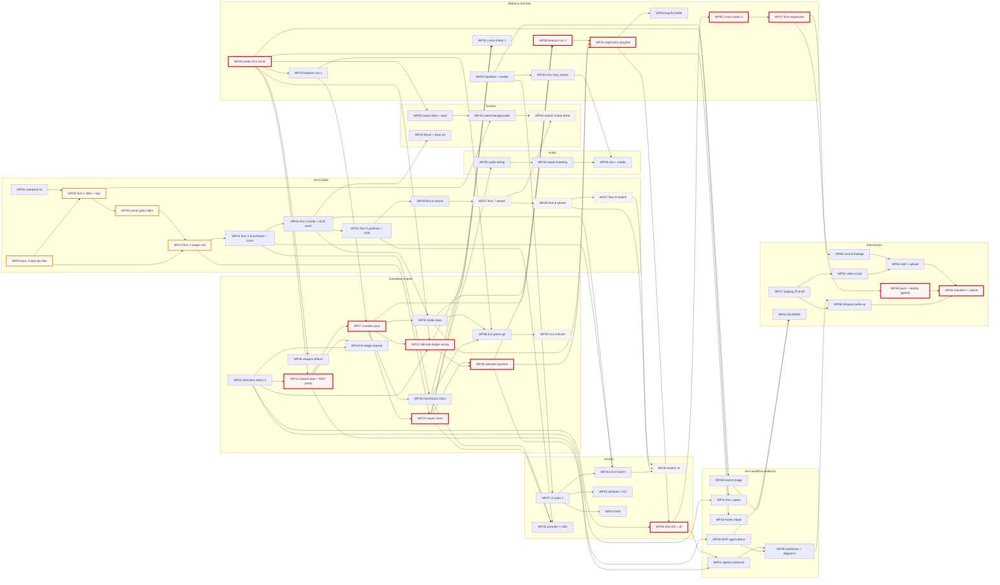

# Plan v1: remaining work for Pumpkin Killer (Kiro task 43a, round 1)

Written 2026-11-09 by Kiro from the repo as it is today. Nothing here was run: no game, no test, no Colab. Every hour figure is my estimate. Round 2 (task 43b) is where the main line corrects it.

**Deadline: to be confirmed by the owner.** The brief says the exact date is not in the repo. It is: `(not published)` line 3 says 2026-12-04 14:00 PT, and the Devpost page lists the submission period as Oct 30 to Dec 4, 2026 ([Kiroween 2026](https://kiroween.devpost.com/), read from a search snippet only; fetching the page returned HTTP 403). The owner's "about 20 days" points to 11-29. I keep the brief's plan: day 0 = 11-09, 18 working days 11-10..11-27, code freeze 11-27, 11-28 and 11-29 for video and submission. Days 11-30..12-03 stay unplanned reserve until the owner answers Q1.

Lane names used in the table: Gameplay = Gameplay engine, Art = Art (Colab), Audio, UI = UI/HUD, Scenes, Test = Balance and test, Kiro = Kiro workflow evidence, Submit = Submission (README, video, Devpost).
Actors: main = main line (Claude), Kiro, Colab, owner, sub = sub-agent. Hours are agent or person work hours, not wall-clock.

---

## a. PLANNING DIAGRAM

Red thick border = critical path (no float). Orange border = near-critical art chain (2 to 3 days float). Grey dashed border = STRETCH. Solid arrows = "depends on". Gates and verification are in the table in section b. I could not render this Mermaid here, so the layout is unchecked.

**Critical path:** WP06 intake -> WP12 shared data -> WP17 number pass -> WP22 and WP23 (end together on 11-16) -> WP30 ultimate machine -> WP38 balance run 2 -> WP44 regression -> WP50 i18n -> WP55 cross-check 2 -> WP57 final regression -> WP59 deploy -> WP62 submit.
**Near-critical:** WP03 -> WP05 -> WP09 -> WP10. WP23 waits for WP17 (ends 11-14), not for WP10 (ends 11-12), so the reaper art has 2 days of float. WP31 (bride) has 3 days of float over Run 4. A Colab slip of more than 2 days moves the critical path onto the art chain.

---

## b. PLAN TABLE

Order is by start date. The order follows one rule: every checkpoint in section c has a playable build, and no WP waits for an image it does not need yet (art is queued by needed-by date, section d). Effort: S = up to 2 h, M = 3 to 6 h, L = 7 h or more. "Colab 41 min" is queue time, not person time. Gate codes: OW1..OW8 are the owner windows in b3, "cross" = cross-check by a sub-agent or a second pass by the main line, "none" = no gate. Verification commands run from the repo root.

| ID | Name | Lane | Owner | Inputs | Outputs | Effort h | Depends on | Start | End | Verification | Gate | Risk | Cut |
|---|---|---|---|---|---|---|---|---|---|---|---|---|---|
| WP01 | Owner decision batch 1 (Q1-Q8, section g) | Gameplay | owner; main prepares | docs/plan_v1.md section g | (not published) (new) | owner 0.3, main 0.2 | - | 11-09 | 11-10 | file holds 8 one-word answers, none blank | owner OW1 | 2 | MVP |
| WP02 | Baseline: all test scripts plus a headless smoke | Test | main | scripts/test_*.js, scripts/test_*.py (9 files), index.html | (not published), (not published) and battle.png | S 2 | - | 11-09 | 11-10 | `node scripts/test_particles.js`, `test_audio.js`, `test_ambient_sfx.js`, `test_wind_fx.js`, `test_i18n.js` and `python3 -B scripts/test_constants_sync.py`, `test_mcp_game.py`, `test_mcp_stdio.py`, `test_postprocess_audio.py` all exit 0 (real last lines pasted in the doc); smoke (load, Start, one throw) shows 0 console errors | none | 2 | MVP |
| WP03 | Kiro task 44: Colab job files for scenes and for drop/ultimate sprites | Art | Kiro 1.5, main 0.5 review | docs/converge_scenes.md section 9, docs/airdrop_asset_requests.md, docs/ultimates_asset_requests.md items 2, 5, 6, 7, 11, colab/jobs.json (schema) | colab/jobs_scenes.json (4 jobs), colab/jobs_misc.json (13 jobs: crate, parachute, 6 airdrop icons, 5 ultimate sprites) | S 2 | - | 11-09 | 11-10 | `python3 -c "import json;[json.load(open(f)) for f in ('colab/jobs_scenes.json','colab/jobs_misc.json')]"` exits 0; job counts 4 and 13; every job has id, tier, ref, prompt, negative. The crate and parachute prompts are not in the repo (grep "parachute" in colab/ finds nothing), so Kiro writes new ones | cross | 2 | MVP |
| WP04 | Colab notebook fix: use the per-job negative prompt, define TAG, add an ONLY list per run | Art | main | colab/pumpkin_assets_job.py, docs/new_class_prompts.md section 0, docs/art_job_order.md | colab/pumpkin_assets_job.py (edited) | S 1 | - | 11-10 | 11-10 | Colab dry run prints the Run 1 ids: bride_idle, hunchback_idle, reaper_idle, bg_belltower, bg_pumpkin_field. Could not verify here: needs Colab | none | 3 | MVP |
| WP05 | Colab Run 1: 3 idles (2 variants) and 2 backgrounds (3 variants) | Art | Colab; owner presses Run | colab/jobs_new_classes.json stage 1, colab/jobs_scenes.json | Drive out/: 12 PNGs (6 idles, 6 backgrounds) | Colab 29 min | WP03, WP04 | 11-10 | 11-10 | 12 files in Drive out/; backgrounds are 16:9; no text or watermark (eye check by main) | none | 4 | MVP |
| WP06 | Intake of Kiro tasks 41 and 42 (outputs unknown today) | Test | main | docs/kiro_task_41.md, docs/kiro_task_42.md, js/ultimate.js, js/class_stats.js, scripts/sim_balance.js, scripts/test_ultimate.js, test_class_stats.js, test_sim_balance.js, js/particles.js, docs/architecture.md, docs/workflow.md | (not published) (real last line of every test run); Kiro's docs/implementation_report.md checked | M 4 | - | 11-10 | 11-11 | main re-runs `node scripts/test_ultimate.js`, `test_class_stats.js`, `test_sim_balance.js`, `test_particles.js`; all exit 0; old preset names unchanged (hash test from task 42). If a module is missing, WP13, WP17, WP22 and WP28 slip by the same days | cross | 3 | MVP |
| WP07 | UI pass 1: wire the generated art (dock_frame, plate_normal/active, lock_plate, top plates), help "?" text, hint overlap, charge ring size | UI | main | assets/ui/*.png, css/dock.css, index.html, docs/asset_mapping_table.md | index.html, css/dock.css, (not published), ui1_1280.png, ui1_1920.png | M 6 | WP02 | 11-10 | 11-12 | screenshots at 800, 1280 and 1920 px: dock_frame.png and plate_*.png load (no 404); hint text and nameplate rectangles do not overlap (overlap test = 0); the "?" panel holds the hold-to-charge, wind and bottom-button sentences in both languages | owner OW3 | 3 | MVP |
| WP08 | Triage and merge the unmerged kiro/* branches (GAP E2 lists 17, 18, 19, 21, 23, 24, 26-29, 31-35); i18n branch last | Kiro | main | git branch list, each branch's test | merged commits, (not published) (branch, test result, merged y/n) | M 5 | WP02 | 11-10 | 11-12 | per branch: its own test exits 0 before the merge; the full test set exits 0 after; one log row per branch. I cannot see git state, so the branch list is an assumption | cross | 4 | MVP |
| WP09 | Owner picks one idle image per new class; main copies the picks to Colab inputs | Art | owner 0.2, main 0.3 | Drive out/ idle PNGs, docs/art_style_guide.md section 5 | Drive inputs/unit_bride.png, unit_hunchback.png, unit_reaper.png | S 0.5 | WP05 | 11-11 | 11-11 | three files in inputs/; sub-agent style check against art_style_guide.md section 5 (head about 40% of height, orange outer outline, no magenta inside) | owner OW2 | 3 | MVP |
| WP10 | Colab Run 2: reaper set (windup, release, hit, portrait), skull, slash arc, spectral spear, crate, parachute | Art | Colab | colab/jobs_new_classes.json, colab/jobs_misc.json | Drive out/: 18 PNGs | Colab 41 min | WP03, WP09 | 11-11 | 11-12 | 18 files; reaper poses show no scythe or skull in the hand (the known prompt risk in docs/new_class_prompts.md section 3) | none | 4 | MVP |
| WP11 | Kiro task 45: specs for the remaining build (new-classes, ultimate-machine, scenes-v2, ai-ledger) | Kiro | Kiro 5, main 1 | docs/ultimate_rules.md, docs/ultimate_mapping.md, docs/class_stats_judgement.md, docs/converge_scenes.md, docs/playtest_fixes.md, docs/implementation_report.md | .kiro/specs/{new-classes,ultimate-machine,scenes-v2,ai-ledger}/{requirements,design,tasks}.md (12 files) | M 6 | WP01, WP06 | 11-11 | 11-13 | 12 files exist; every requirements.md line is EARS with a number; the rules-reviewer agent run on the four folders reports no conflict with .kiro/steering/rules.md | cross | 2 | MVP |
| WP12 | Shared data and MCP parity: (not published), constants WIND_ACCEL, HEAL_AMOUNT, AI_AIM_ERROR, MCP wind as acceleration, class ids | Gameplay | main | shared/constants.json, scripts/mcp_game_server.py, scripts/mcp_stdio_server.py, js/class_stats.js, docs/class_stats_judgement.md | (not published) (new), shared/constants.json, both MCP scripts, scripts/test_constants_sync.py (extended) | M 5 | WP01, WP06 | 11-11 | 11-13 | `python3 -B scripts/test_constants_sync.py`, `test_mcp_game.py`, `test_mcp_stdio.py` exit 0; new parity check on 20 (angle, power, wind) cases: landing x from the browser integrator, the MCP engine and sim_balance differ by 3 px or less | owner OW1 (Q7; tech.md says ask before changing wind) | 3 | MVP |
| WP13 | Balance sim run 1: provisional values vs the recommended table | Test | main | scripts/sim_balance.js, js/class_stats.js | (not published) (win-rate matrix, hits-to-kill, violated bands) | S 2 | WP06 | 11-12 | 11-12 | `node scripts/sim_balance.js --matches 200 --seed 7` run twice prints identical output; matrix printed for both value sets | none | 2 | MVP |
| WP14 | Colab Run 3: hunchback set, bell, 4 skill icons | Art | Colab | colab/jobs_new_classes.json, colab/ui_jobs_kiro.json (ui_icon_normal, _double, _heavy, _heal) | Drive out/: 18 PNGs | Colab 41 min | WP10 | 11-12 | 11-13 | 18 files; hunchback poses have empty hands or the accepted bell-in-hand fallback (docs/new_class_prompts.md section 6); icons carry no hat or character leak | none | 4 | MVP |
| WP15 | Kiro task 46: (not published) (every asset path in index.html, css and js/audio.js exists; every audio file has a CREDITS.md row) | Test | Kiro 2, main 0.5 | index.html, css/dock.css, js/audio.js, assets/audio/CREDITS.md | (not published) (new) | S 2.5 | WP02 | 11-12 | 11-13 | `python3 -B (not published)` exits 0 on the tree and exits non-zero on a temp copy with one referenced file deleted | cross | 2 | MVP |
| WP16 | Hooks repair plus new save hooks for test_ultimate and test_class_stats (owner fixes the write permission, GAP E6) | Kiro | Kiro 1.5, owner 0.5, main 0.5 | .kiro/hooks/*.kiro.hook (3 files; test-rig-on-save is an intentional no-op) | .kiro/hooks (5 or more files), (not published) | S 2.5 | WP06 | 11-12 | 11-14 | each hook command run by hand exits 0; one save of js/ultimate.js in Kiro triggers its hook (log saved) | none | 3 | MVP |
| WP17 | Number pass in index.html from the class table: per-class HP and damage, heal 30, wind-sound scale /4, shield counts only unit hits, frost curse -20%, single bat shuriken 26 | Gameplay | main | js/class_stats.js, docs/class_stats_judgement.md, docs/playtest_fixes.md Fix 1 and 4, (not published), index.html | index.html (HERO_PROFILES, bounce code, heal), (not published) | M 5 | WP12, WP13 | 11-13 | 11-14 | headless: 1000 knight throws with a unit contact deal 30.0 +/- 0.05; bat single = 26; heal shows +30; `node scripts/test_class_stats.js` and `python3 -B scripts/test_constants_sync.py` exit 0. Values assume Q2 | cross | 3 | MVP |
| WP18 | Colab Run 4: bride set, sound wave, HUD parts (top-centre plate, hp frame/fill, wind frame/arrow, fence damaged/broken) | Art | Colab | colab/jobs_new_classes.json, colab/ui_jobs_kiro.json | Drive out/: 24 PNGs | Colab 53 min | WP14 | 11-13 | 11-14 | 24 files; fence images keep the footprint of assets/env/fence_black_intact.png (width/height ratio within 10%) | none | 4 | MVP |
| WP19 | AI landing-ledger learner replaces the exact simulator; AI class fixed per match | Gameplay | main | index.html (aiAttackNow, estimatePowerForTarget, simulateLandingX, triggerAITurn), docs/playtest_fixes.md Fix 2 | index.html | M 5 | WP01, WP12 | 11-13 | 11-15 | static search: AI path has 0 calls to simulateLandingX or estimatePowerForTarget; 400 headless matches vs a fixed dummy: round-1 hit rate 10-25%, rounds 4-6 33-48%, rounds 4-6 at least 12 points above rounds 1-2 | owner OW1 (Q4) | 3 | MVP |
| WP20 | Scene data table (wind range, ground, bg), start-screen cards, reset on return to start | Scenes | main | index.html (SCENES, startMatch, showStartScreen), docs/converge_scenes.md section 7 | index.html | M 4 | WP06 | 11-13 | 11-15 | headless, 200 rounds per scene: bell tower abs(wind) in 1.5..4, pumpkin field 0..2.5, graveyard -4..4; screenshot of 3 cards with missing art greyed and unclickable; scene A -> B -> A gives a pixel-identical first frame | none | 2 | MVP |
| WP21 | Colab Run 5: portraits skeleton/bat/knight, power cells x3, sockets x2 | Art | Colab | colab/ui_jobs_kiro.json | Drive out/: 16 PNGs | Colab 37 min | WP18 | 11-14 | 11-15 | 16 files; portraits face RIGHT; the 3 power cells differ visibly | none | 3 | MVP |
| WP22 | Ultimate ledger wiring: per-unit pips, gold menu entry, arm/cancel, spend on release (the ultimate throw gives 0 pips), used-count runes in the top plate | Gameplay | main | js/ultimate.js, docs/ultimate_rules.md section 2, index.html (energy, ultUsed, ultArmed, toggleUltimate, actionMenuItems) | index.html | M 6 | WP01, WP06, WP17 | 11-14 | 11-16 | `node scripts/test_ultimate.js` exits 0; headless: 3 hits -> ready; blocked, missed and fence hits add 0; two hits in one throw add 1; after use pips = 0; third use refused; screenshots with 0, 1, 2, 3 pips | owner OW1 (Q6) | 3 | MVP |
| WP23 | Reaper class: skull projectile, hit box, execute rule (target at 30% HP or less takes x1.5), class card | Gameplay | main | Drive out/ reaper_*, proj_skull; scripts/key_magenta_items.py, key_skeleton_poses.py; docs/class_stats_judgement.md 6c | (not published), assets/poses/reaper_*.png, (not published), index.html (HERO_PROFILES, HAND_RIG, HELD_WEAPON) | M 5 (keying 1) | WP10, WP17 | 11-14 | 11-16 | keyed PNGs contain 0 magenta-like pixels (R>200, G<80, B>200); headless: skull 22, 33 on a target at 30% HP or less, 0 when the sky shield blocks; screenshots for both teams show the skull pointing along its motion; the card is selectable only when its images loaded | owner OW3 | 3 | MVP |
| WP24 | Fence and drop art wiring: fence_black_intact now, damaged and broken from Run 4; crate and parachute from Run 2 (estimate includes both) | Scenes | main | assets/env/fence_black_intact.png, Drive out/ env_fence_damaged, env_fence_broken, drop_crate, drop_parachute, index.html fence and drop draw code | assets/env/fence_black_damaged.png, fence_black_broken.png, drop_crate.png, drop_parachute.png (names proposed), index.html | M 3 | WP18 | 11-15 | 11-16 | screenshots at wall HP 100, 50, 0 show 3 states; one screenshot of a landing drop shows crate on a parachute; `python3 -B scripts/test_constants_sync.py` exits 0; headless probe: collision box still x 895..1025, top y 610 | none | 2 | MVP |
| WP25 | UI art batch wiring: skill icons, hp frame/fill, wind frame/arrow, top-centre plate | UI | main | Drive out/ ui_icon_*, ui_hp_*, ui_wind_*, ui_top_center_plate; css/dock.css; index.html (drawTopHUD) | assets/ui/*.png (new), css/dock.css, index.html | M 5 (keying incl.) | WP07, WP14, WP18 | 11-15 | 11-17 | screenshot at 1920 px: no emoji glyph left on the skill buttons; hp text contrast at least 4.5:1 (WCAG formula on sampled pixels); the wind arrow flips with the sign of the wind | owner OW4 | 3 | MVP |
| WP26 | Hunchback class: bell projectile, knockback 50 px inside move bounds, speed factor 0.8 | Gameplay | main | Drive out/ hunchback_*, proj_bell; docs/class_stats_judgement.md 6b | (not published), assets/poses/hunchback_*.png, (not published), index.html | M 5 | WP14, WP17 | 11-16 | 11-18 | headless: damage 20; knockback 50 px keeps the unit inside move bounds; range at 54 deg is 1183 px +/- 5%; screenshots for both teams | cross | 3 | MVP |
| WP27 | Kiro task 47: (not published) first draft (criterion -> evidence -> gap -> fix, video beats). The file does not exist today although a spec points to it | Submit | Kiro 4, main 1 | .kiro/specs/judging-fit/*, README.md, .kiro/**, docs/ROLES.md | (not published) (new) | M 5 | - | 11-16 | 11-18 | every file path it cites exists (checked with the WP15 script style); criteria text pasted by the owner or main from the Devpost page, because Kiro got HTTP 403 | cross | 3 | MVP |
| WP28 | Weapon effects wiring: 7 new presets from task 42, dark pass under ribbons, outlines, particle budget | Gameplay | main | js/particles.js, js/particles_draw.js, docs/playtest_fixes.md section 1c | index.html, js/particles_draw.js | M 5 | WP06 | 11-17 | 11-20 | `node scripts/test_particles.js` exits 0; headless counts: at most 70 particles per unit hit, 500 alive in fxSys, 80 legacy; per weapon, 3 screenshots (over the moon, mid sky, near ground) with contrast 3.0 or more between projectile and its 40 px ring | cross | 3 | MVP |
| WP29 | Colab Run 6: reruns of failed MVP images (budget 18) | Art | Colab | failure notes from WP23, WP24, WP25, WP26 | Drive out/ reruns | Colab 41 min | WP21 | 11-17 | 11-18 | each rerun passes the check it failed; unfixed ones logged for the cut ladder | none | 4 | MVP |
| WP30 | Ultimate machine: trigger hit, then 3 follow-up strikes of 0.5 x normal damage, shared by all 7 classes; reaper first | Gameplay | main | js/ultimate.js, docs/ultimate_mapping.md, docs/new_class_prompts.md sections 1-3, Drive out/ fx_scythe_slash_arc and ult_spectral_spear (keyed), index.html | index.html | L 8 | WP22, WP23 | 11-17 | 11-20 | headless, 7 classes: follow-up sum = 1.5 x normal +/- 1; trigger blocked or missed -> 0 follow-ups; most damage on one unit from full HP at most 75; reaper screenshot with 3 slashes 0.18 s apart. Reach radii (150/240/260 px) only matter if WP40 ships | cross; owner OW1 (Q6) | 4 | MVP |
| WP31 | Bride class: sound wave, hit half-width 105, damage 100% down to 45%, speed factor 0.9 | Gameplay | main | Drive out/ bride_*, proj_soundwave; docs/class_stats_judgement.md 6a | (not published), assets/poses/bride_*.png, (not published), index.html | M 5 | WP17, WP18 | 11-17 | 11-19 | headless: dx 30 -> 27, dx 105 -> 12.15, dx 106 -> 0; blocked by fence and by sky shield; screenshot of the wave | cross | 3 | MVP |
| WP32 | Scene backgrounds: bell tower and pumpkin field, safe-zone checks | Scenes | main | Drive out/ bg_belltower, bg_pumpkin_field; docs/converge_scenes.md sections 3, 4, 7 | assets/env/bg_belltower.png, bg_pumpkin_field.png, index.html, (not published) | M 4 | WP05, WP20 | 11-18 | 11-20 | the 10 checks of converge_scenes section 7 logged pass/fail; one 1920x1080 screenshot per scene; HUD zone y 0..110 contrast at least 3:1; a scene that fails stays a greyed card | owner OW5 | 4 | MVP |
| WP33 | Portraits and power/socket cells wired; start-screen cards with real art | UI | main | Drive out/ portrait_*, ui_power_*, ui_socket_*, and the 3 new portraits | assets/ui/portrait_*.png, index.html, css/dock.css | M 4 | WP21, WP23, WP26 | 11-18 | 11-20 | screenshot: the top plate shows a portrait for each loaded class; emoji portrait only in the fallback branch (grep); power bar shows 3 distinct states | none | 2 | MVP |
| WP34 | Cross-check 1 by independent sub-agents (rules vs (not published), art vs art_style_guide.md, HUD readability) | Test | sub 3, main 0.5 | build of 11-18, .kiro/steering/rules.md, docs/art_style_guide.md | (not published) | S 3.5 | WP22, WP23, WP26 | 11-18 | 11-18 | each rule in rules.md marked pass or fail with file and line; fails triaged into WP53 | cross | 2 | MVP |
| WP35 | Audio wiring for the new classes and ultimates from existing CC0 files | Audio | main | docs/new_class_prompts.md section 5, docs/audio_event_map.json, js/audio.js, assets/audio/sfx/* | docs/audio_event_map.json, js/audio.js | M 4 | WP23 | 11-19 | 11-21 | `node scripts/test_audio.js` exits 0; `python3 -B (not published)` exits 0; a scripted headless match fires throw_skull, impact_skull, scythe_slash x3, throw_wave, throw_bell and ult_toll at least once with 0 audio 404s | none | 2 | MVP |
| WP36 | 2 v 2 go/no-go gate | Gameplay | owner 0.1, main 0.2 | (not published), section b2 load table | line in (not published) | S 0.3 | WP13, WP26, WP31 | 11-19 | 11-19 | go only if hours spent are at most plan + 4 h, all 7 classes' art loaded, and at least 14 free hours before 11-25 (or Q1 confirmed 12-04); otherwise no-go, written down | owner OW4 | 3 | MVP |
| WP37 | Colab Run 7: ground strips x2, airdrop icons x6, plate hover and disabled x2 | Art | Colab | colab/jobs_scenes.json, colab/jobs_misc.json, colab/ui_jobs_kiro.json | Drive out/: 20 PNGs | Colab 45 min | WP29 | 11-19 | 11-20 | files exist. Runs only if WP29 left no unresolved MVP failure | none | 2 | STRETCH |
| WP38 | Balance sim run 2 with all 7 classes; tune at most 2 numbers per class | Test | main | scripts/sim_balance.js, index.html, (not published) | (not published), (not published) | M 4 | WP17, WP30, WP31 | 11-20 | 11-21 | `node scripts/sim_balance.js --matches 200 --seed 7` exits 0: all 21 pairings between 40% and 60%, class averages 45-55%, hits-to-kill 3..8 per cell; WP12 parity (20 cases, 3 px) still passes | cross | 4 | MVP |
| WP39 | Colab Run 8: scythe item, dirge ring, toll ring, 4 ult2 sprites, pip socket, shockwave ring, ricochet shield, shuriken shadow | Art | Colab | colab/jobs_new_classes.json, colab/jobs_misc.json | Drive out/: 22 PNGs | Colab 49 min | WP37 | 11-20 | 11-21 | files exist | none | 2 | STRETCH |
| WP40 | 2 v 2: unit array, per-side turn queue, HUD for 4 units | Gameplay | main | index.html, docs/roster_design.md (turn-flow part only), docs/review_reconcile.md C12 | index.html, scripts/sim_balance.js | L 14 | WP36 | 11-20 | 11-25 | the 1 v 1 smoke of WP02 still passes; 100 seeded 2 v 2 headless matches: each live unit acts once per round, dead units skipped, same-team spacing 160 px or more; screenshot with 4 units and 4 hp bars, no overlap | cross | 5 | STRETCH |
| WP41 | Win and lose screens with the same wording, KO animation | UI | main | index.html end-of-game code | index.html | M 3 | WP07 | 11-21 | 11-22 | screenshots of a win and a loss both show a result word and the KO frame of the defeated unit | none | 2 | MVP |
| WP42 | Owner listens: one full match, volume notes (GAP D3: nobody has heard the game) | Audio | owner | the build, assets/audio/** | (not published) | S 0.7 | WP35 | 11-21 | 11-21 | file holds 3 one-word notes: music, sfx, ambient = louder, ok or quieter | owner OW5 | 3 | MVP |
| WP43 | Fonts: one OFL display font, Latin subset; CJK uses the system font | UI | main | docs/ui_reskin_plan.md (font part, not re-read by me), css/dock.css | assets/fonts/*.woff2 and its licence file (new), css | S 2.5 | WP07 | 11-21 | 11-22 | `document.fonts.check` is true for the new font in the headless run; font file at most 60 KB; licence text saved next to it | none | 2 | MVP |
| WP44 | Regression playtest: 100 headless matches with the Fix-0 logger, plus a sub-agent report | Test | main 3, sub 1 | docs/playtest_fixes.md Fix 0, scripts/playtest_receiver.py, the build | (not published), (not published) | M 4 | WP30, WP31, WP38 | 11-21 | 11-22 | 0 assertion violations in 100 matches (one AI throw per round, damage clipped to remaining HP, no NaN); 0 console errors; every match ends in 14 rounds or fewer. Strings freeze after this WP | cross | 3 | MVP |
| WP45 | Stretch scene items: ground strips, wind and particle themes, bell-toll shake | Scenes | main | Drive out/ ground strips, docs/converge_scenes.md sections 3-5 | (not published), ground_strip_pumpkin.png, index.html | M 4 | WP32, WP37 | 11-21 | 11-23 | no seam at the ground top (+/- 8 px) in a screenshot per scene; the toll adds +0.5 wind capped at 4, tested over 200 rounds | none | 3 | STRETCH |
| WP46 | Audio mix pass and CREDITS completeness | Audio | main | (not published), assets/audio/CREDITS.md, js/audio.js gains | js/audio.js, assets/audio/CREDITS.md | S 2 | WP15, WP42 | 11-22 | 11-23 | `python3 -B (not published)` exits 0 (every audio file has a credit row); gains follow the notes | none | 2 | MVP |
| WP47 | Colab Run 9 (art freeze 11-22): wizard cut-ins x3, ghostfire x2, candle, round buttons x2 | Art | Colab | colab/ui_jobs_kiro.json | Drive out/: 16 PNGs | Colab 37 min | WP39 | 11-22 | 11-22 | files exist; art after 11-22 is not wired | none | 2 | STRETCH |
| WP48 | MCP agent demo: a stdio session plus a learning curve | Kiro | Kiro 4, main 1 | scripts/mcp_stdio_server.py, scripts/eval_agent_learning.py, .kiro/settings/mcp.json, docs/mcp_agent_protocol.md | (not published), (not published) | M 5 | WP12 | 11-22 | 11-24 | `python3 -B scripts/test_mcp_stdio.py` exits 0; `python3 -B scripts/eval_agent_learning.py` prints a per-round table where mean landing error of rounds 5-8 is below rounds 1-4; the session file shows get_public_state, submit_action, end_turn, get_history in order | cross | 3 | MVP |
| WP49 | Stretch UI wiring: cut-in portraits, ghostfire, candle, round buttons, hover and disabled plates | UI | main | Drive out/ (Runs 7-9) | assets/ui/*, css/dock.css, index.html | M 4 | WP25, WP39, WP47 | 11-22 | 11-24 | one screenshot at 1920 px; anything delivered after 11-22 is ignored | none | 2 | STRETCH |
| WP50 | i18n: merge kiro/i18n, move all strings into the dictionary, default English, 中文 toggle | UI | main | js/i18n.js, scripts/test_i18n.js, index.html | index.html, js/i18n.js | M 6 | WP01, WP44 | 11-23 | 11-25 | `node scripts/test_i18n.js` exits 0; grep for CJK characters in index.html outside the i18n table finds 0 lines; screenshots of start, battle and win screens in both languages | owner OW1 (Q5), then OW6 | 4 | MVP |
| WP51 | Demo video script and shot list (under 3 min, plus a 90 s cut) | Submit | Kiro 3, main 0.5 | (not published), .kiro/specs/judging-fit/requirements.md items 7, 8 | (not published) | S 3.5 | WP27 | 11-23 | 11-24 | total at most 180 s; each beat names a file or screen; no beat shows a feature the checkpoint table does not list as built | cross | 2 | MVP |
| WP52 | README rewrite in English: run, test commands, stack, Colab art, Kiro use | Submit | main | README.md, docs/architecture.md, docs/workflow.md | README.md | M 3 | WP08, WP48 | 11-24 | 11-25 | every command in the README is run once and exits 0; no sentence says Kiro made images; history and stack sentences agree with .kiro/steering/*.md | cross | 2 | MVP |
| WP53 | Bug-fix buffer (reserved) | Test | main | docs/crosscheck_*.md, docs/playtest_*.md | fixes in index.html and others | L 10 | WP44 | 11-24 | 11-27 | each fix has a test or a before/after screenshot | none | 3 | MVP |
| WP54 | Custom agents on the release candidate: rules-reviewer on the diff, tester on the new tests, transcripts saved | Kiro | Kiro 2, main 0.5 | .kiro/agents/*.json, diff since 11-09 | (not published), tester_run.md | S 2.5 | WP30, WP50 | 11-25 | 11-25 | rules-reviewer lists each rule of rules.md as pass or fail; fails go to WP53 | none | 2 | MVP |
| WP55 | Cross-check 2 on the release candidate: 3 independent sub-agents (rules, readability at 800/1280/1920, art style) | Test | sub 3, main 0.5 | RC build | (not published) | S 3.5 | WP50 | 11-25 | 11-25 | all fails triaged; P0 count must be 0 by 11-27 | cross | 2 | MVP |
| WP56 | Worktree and branch evidence; architecture and workflow diagrams refreshed (dashed -> solid for what shipped) | Kiro | main 2, Kiro 1.5 | `git worktree list`, docs/architecture.md, docs/workflow.md | (not published), updated diagrams | S 3.5 | WP48, WP54 | 11-26 | 11-26 | every solid box in architecture.md maps to a file that exists; one worktree row per kiro/* branch | none | 2 | MVP |
| WP57 | Final regression, performance check, screenshots | Test | main | everything | (not published), docs/playtest/frames/final/*.png | M 5 | WP55 | 11-26 | 11-27 | every test script exits 0; 100-match headless run clean; 3 scenes at 1920x1080 plus the start screen at 800 px; frame time p95 at most 20 ms in a 5-round match (needs the owner's machine, not verified here) | cross | 3 | MVP |
| WP58 | Devpost write-up, draft then final; counts taken from file listings | Submit | Kiro 3, main 2 | (not published), docs/architecture.md, docs/workflow.md, README.md | (not published) (new) | M 5 | WP27, WP56 | 11-26 | 11-28 | counts in the text (task briefs, specs, hooks, agents, steering) equal `ls` counts on 11-27; no sentence says Kiro generated images; every "works" claim has a test or screenshot path | cross | 3 | MVP |
| WP59 | Push and deploy to GitHub Pages (gated) | Submit | main | repo | public URL | S 1 | WP57 | 11-27 | 11-27 | the URL loads the start screen, one throw works, 0 console errors on the deployed page | owner OW7 explicit yes | 3 | MVP |
| WP60 | Record gameplay footage per the script | Submit | owner 2, main 2 | (not published), RC build | raw video | M 4 | WP57 | 11-28 | 11-28 | every script beat is present; nothing unbuilt is shown | none | 3 | MVP |
| WP61 | Edit the video and upload to YouTube (unlisted until the owner says yes) | Submit | owner | raw video, (not published) | YouTube URL | M 4 | WP51, WP60 | 11-28 | 11-29 | duration under 3:00; URL opens when logged out | owner OW8 | 3 | MVP |
| WP62 | Submission checklist and read-back | Submit | main | .kiro/specs/judging-fit/requirements.md item 9 | (not published) | S 2 | WP58, WP59, WP61 | 11-29 | 11-29 | each item of requirement 9 ticked with evidence: LICENSE is OSI, `.kiro/` not in .gitignore, no Co-Authored-By trailer in git log (main runs it) | owner OW8 explicit yes | 3 | MVP |

Totals: 62 WPs, 56 MVP and 6 STRETCH (WP37, WP39, WP40, WP45, WP47, WP49). The WP36 gate is MVP.

### b1. Hours at a glance

| Who | MVP hours | STRETCH hours | Note |
|---|---|---|---|
| main line | 147.7 (includes a 10 h bug buffer, WP53, and 4 h of checking Kiro output) | 22 (WP40 14, WP45 4, WP49 4) | the bottleneck: it wires, verifies and commits everything |
| Kiro | 27.5 (WP03 1.5, WP11 5, WP15 2, WP16 1.5, WP27 4, WP48 4, WP51 3, WP54 2, WP56 1.5, WP58 3) | 0 | plus tasks 41 and 42, already running |
| sub-agents | 7 (WP34 3, WP44 1, WP55 3) | 0 | independent checks |
| Colab queue | 242 min = 4.0 h | 131 min = 2.2 h | section d |
| owner | about 9 h, of which 6 h are footage and video (WP60, WP61) | 0 | the review part is about 3 h in 8 short windows |

### b2. Main-line load by day (hours spread evenly over each WP's days; rounded)

| Date | 11-09 | 11-10 | 11-11 | 11-12 | 11-13 | 11-14 | 11-15 | 11-16 | 11-17 | 11-18 | 11-19 |
|---|---|---|---|---|---|---|---|---|---|---|---|
| Hours | 1.1 | 8.3 | 7.6 | 7.3 | 8.7 | 9.7 | 9.8 | 8.5 | 8.3 | 10.8 | 9.1 |
| Cumulative | 1.1 | 9.4 | 17.0 | 24.4 | 33.0 | 42.7 | 52.5 | 61.0 | 69.3 | 80.1 | 89.2 |

| Date | 11-20 | 11-21 | 11-22 | 11-23 | 11-24 | 11-25 | 11-26 | 11-27 | 11-28 | 11-29 |
|---|---|---|---|---|---|---|---|---|---|---|
| Hours | 9.2 | 7.6 | 5.6 | 3.3 | 6.8 | 7.0 | 7.7 | 6.7 | 2.7 | 2.0 |
| Cumulative | 98.4 | 106.0 | 111.6 | 114.9 | 121.7 | 128.7 | 136.4 | 143.1 | 145.7 | 147.7 |

Average over the 18 working days: 8.2 h/day. Peak: 10.8 h on 11-18. I do not know the main line's real capacity; the plan assumes about 8 h/day of agent work. If actual cumulative hours at a checkpoint run 12 h or more behind this table, use the cut ladder in b5.

### b3. Owner windows (batched one-word questions; each window is 5 to 30 minutes)

| Window | Date | What the owner answers |
|---|---|---|
| OW1 | 11-10 | Q1 to Q8 of section g, one word each |
| OW2 | 11-11 | pick A or B for each of the 3 idle images; 5-minute fix of the hook write permission (WP16) |
| OW3 | 11-16 | ok or redo for four screenshots: dock and top plates (WP07), reaper (WP23), help panel, hint text |
| OW4 | 11-19 | go or no-go for 2 v 2 (WP36); ok or redo for the new HUD art screenshot (WP25) |
| OW5 | 11-21 | listening session, 3 one-word notes (WP42); ok or redo for the 3 scene screenshots (WP32) |
| OW6 | 11-25 | play one match in English and one in 中文; ok or redo |
| OW7 | 11-27 | push and deploy: yes or no (WP59) |
| OW8 | 11-28 and 11-29 | record and edit the video (WP60, WP61); final yes to submit (WP62) |

### b4. Scope verdict: 1 v 1 with 7 classes; 2 v 2 gated; 4 v 4 not scheduled

| Option | Extra main-line hours | Average load over 18 days | Verdict |
|---|---|---|---|
| 1 v 1, 7 classes (this plan) | 0 | 8.2 h/day | ship |
| plus 2 v 2 (WP40) | 14 | 9.0 h/day | only if the WP36 gate says go on 11-19, or if Q1 confirms 12-04 and the work moves into 11-28..12-02 |
| plus 4 v 4 | about 44 (14 array refactor shared with 2 v 2, 6 HUD and dock for 8 units, 4 AI ledger per unit, 6 shield/move/airdrop per unit, 8 sim and rebalance for 4 v 4, 6 QA) | 10.7 h/day on average, as high as the busiest day of the base plan (10.8 h on 11-18) held for all 18 days | do not build |

Why: the unit array is the expensive part. `index.html` is about 2,500 to 2,900 lines (I read to line 2503 and the file ends before 2900) and uses global `player` and `ai` objects in the aim, menu, move, HUD and AI code. The 4 v 4 estimate is a hand number with no measurement behind it, which is another reason not to commit to it. Geometry is not the obstacle: 4 units at 160 px spacing need 480 px of the 690 px move zone (x 160..850). The owner said "at most 4 v 4", and `docs/review_reconcile.md` reads that as a ceiling.

### b5. Cut ladder (use in this order when behind)

| Step | Cut | Main-line hours saved | Condition |
|---|---|---|---|
| 1 | every STRETCH WP (WP37, 39, 40, 45, 47, 49) | 22, plus 2.2 Colab hours | behind by 12 h at any checkpoint |
| 2 | fonts (WP43) and KO animation reduced to text (part of WP41) | 4.5 | still behind at the next checkpoint |
| 3 | pumpkin field scene (half of WP32; the owner asked for 3 scenes, so this needs a yes) | 2 | owner OW4 |
| 4 | bride class (WP31 and its share of WP33, WP35); 6 classes is the owner's floor | 6 | the bride has no usable art or balance by 11-18 |
| total | | 34.5 | |

---

## c. CHECKPOINTS

"Done by" lists the WPs that end on or before the date. A checkpoint is passed only when the go rule holds; the no-go column says what happens instead. Plan cumulative main-line hours (b2) are the yardstick for "behind".

| Date | Done by | What a judge could see in a 90-second demo | Go rule | If no-go |
|---|---|---|---|---|
| CP1 11-12 | WP01-WP10, WP13 | Start screen with 4 playable classes, 3 greyed class cards (bride, hunchback, reaper) and 3 scene cards (bell tower and pumpkin field greyed). The new black-iron dock and plates, a readable help panel. Choose the skeleton, throw twice, read the wind. Nothing new in the rules yet; tests are green | WP02 baseline: all 9 scripts exit 0 and the smoke shows 0 console errors; Q1-Q8 answered; Runs 1 and 2 delivered at least 27 of their 30 images; cumulative hours 24.4 (plan) | Unanswered question: use the default written in section g and log it. Idle art unusable for a class: rerun that idle once in Run 3; a second failure triggers cut ladder step 4 for that class early |
| CP2 11-15 | WP11-WP21 | 4 classes with different HP and damage; an AI whose hit rate visibly rises over rounds (the per-round table from the WP19 test); 3 scene cards with real wind ranges; MCP parity green; Kiro specs for the build exist. All 88 MVP images of Runs 1-5 are in Drive | Parity 20 of 20 cases within 3 px; AI criteria of WP19 pass; (not published) exists; at least 80 of 88 MVP images delivered; cumulative hours at most 64.5 (plan 52.5 + 12) | Fewer than 80 images: skip Run 6 reruns for UI parts and fix class art first. Hours over 64.5: cut ladder step 1 |
| CP3 11-18 | WP22-WP27, WP29, WP34 | 6 playable classes (the 4 plus reaper and hunchback), the owner's floor. Arm the ultimate from the menu with 3 lit pips (follow-up strikes still in progress), new fence states, real skill icons, HP frame and wind frame. A judging_fit.md draft exists | At least 6 classes selectable with loaded art; `node scripts/test_ultimate.js` exits 0; cross-check 1 has no open P0; cumulative hours at most 92.1 | Only 5 classes: stop all non-class work for 1 day, rerun the failing art in Run 6 and apply cut ladder step 3. P0 open: it enters WP53 on the same day |
| CP4 11-21 | WP28, WP30-WP33, WP35-WP39, WP42 | All 7 classes. A bell tower match: pick the reaper, 3 hits, arm, skull plus 3 scythe slashes. 3 scenes selectable if their art passed. Weapon effects, new sounds, listening notes recorded | (not published): 21 of 21 pairings between 40% and 60% (at most 3 documented exceptions); the 2 v 2 decision is written; cumulative hours at most 118 | Pairings out of band after two tuning passes: ship with the exception listed, stop tuning. Hours over 118: cut ladder steps 2 and 3 |
| CP5 11-24 | WP41-WP49, WP51 | The full polished loop: fonts, KO screen, all HUD art, regression-clean, MCP agent demo evidence, hooks repaired, video script. English strings in progress | 0 assertion violations in the 100-match run; art and strings frozen since 11-22; no P0 older than 24 h | Switch every remaining hour to WP53; no new features |
| CP6 11-27 | WP40 (if gated in), WP50, WP52-WP57, WP59 | Release candidate in English and 中文, deployed link (only with the owner's yes), final screenshots, Devpost draft complete | Every test script exits 0; cross-check 2 has 0 P0; the 3 scene checks pass; owner yes for the deploy | Ship the last green commit (tag it at CP5) and deploy that |
| CP7 11-29 | WP58, WP60-WP62 | Video under 3 min on YouTube, Devpost entry filled, checklist ticked | Every item of requirement 9 in the judging-fit spec is ticked with evidence; owner says yes | Submit the last green commit with a shorter video. If Q1 confirms 12-04, there are 5 spare days |

---

## d. ART BUDGET

Model of cost: 2 minutes per image, 2 variants per job (3 for the backgrounds, because the 16:9 and empty-lane rules are the hardest), 5 minutes of model load per run, and a rerun allowance of 18 images (about 20% of the MVP total). All art is made on Colab; nothing here is drawn or faked by code. Prompt files: `colab/jobs_new_classes.json` (26 jobs, tier NEW2, with `docs/new_class_prompts.md`), `colab/ui_jobs_kiro.json` (39 jobs, tier U2, with `docs/art_job_order.md`), and two files WP03 creates: `(not published)` and `(not published)`.

### d1. Images still needed, by type

| Type | MVP jobs | MVP images | STRETCH jobs | STRETCH images | Prompt source |
|---|---|---|---|---|---|
| New-class idle (bride, hunchback, reaper) | 3 | 6 | 0 | 0 | jobs_new_classes.json |
| New-class poses (windup, release, hit x3) | 9 | 18 | 0 | 0 | jobs_new_classes.json |
| New-class portraits | 3 | 6 | 0 | 0 | jobs_new_classes.json |
| New-class projectiles (sound wave, bell, skull) | 3 | 6 | 0 | 0 | jobs_new_classes.json |
| Reaper slash arc | 1 | 2 | 0 | 0 | jobs_new_classes.json |
| Scythe item, dirge ring, toll ring, 4 ult2 sprites | 0 | 0 | 7 | 14 | jobs_new_classes.json |
| HUD parts: 4 icons, top-centre plate, hp frame, hp fill, wind frame, wind arrow, fence damaged, fence broken | 11 | 22 | 0 | 0 | ui_jobs_kiro.json |
| Old-class portraits, power cells x3, sockets x2 | 8 | 16 | 0 | 0 | ui_jobs_kiro.json |
| Plate hover and disabled; wizard cut-ins x3; ghostfire x2; candle; round buttons x2 | 0 | 0 | 10 | 20 | ui_jobs_kiro.json |
| Backgrounds (bell tower, pumpkin field) | 2 | 6 | 0 | 0 | jobs_scenes.json |
| Ground strips (bell tower, pumpkin field) | 0 | 0 | 2 | 4 | jobs_scenes.json |
| Crate, parachute | 2 | 4 | 0 | 0 | jobs_misc.json |
| Six airdrop icons | 0 | 0 | 6 | 12 | jobs_misc.json |
| Ultimate sprites: spectral spear (MVP); pip socket, shockwave ring, ricochet shield, shuriken shadow (STRETCH) | 1 | 2 | 4 | 8 | jobs_misc.json |
| **Total** | **43** | **88** | **29** | **58** |  |

Pool: 72 jobs (43 MVP, 29 STRETCH), 146 images. Not planned at all: the two hero-chip jobs of U2 (`ui_hero_chip_normal`, `ui_hero_chip_active`, 4 images), because the start screen now picks the character and the chips are hidden; and 11 of the 16 sprites in `docs/ultimates_asset_requests.md` (items 1, 3, 4, 8, 9, 10, 12, 13, 14, 15, 16), because every ultimate uses one trigger-then-follow-up machine with code particles. Eight U2 jobs are already in `assets/ui/` and `assets/env/` (dock frame, two plates, lock plate, two top plates, fence, wizard portrait); GAP A3 counts the other 31.

### d2. Runs, in order

Each run is images x 2 min + 5 min load. The queue is ordered by the date a WP needs the image, not by type. The reaper goes first because its skull is a single-target projectile, so it is the cheapest class to integrate. The three idles run first because the pose jobs use the approved idle as reference (`docs/new_class_prompts.md` section 0). The backgrounds ride in Run 1 although they are needed on 11-18: that surfaces the "can Colab make 16:9 with an empty ground lane" question 8 days early.

| Run | WP | Date | Content | Jobs | Images | Minutes | Needed by |
|---|---|---|---|---|---|---|---|
| 1 | WP05 | 11-10 | 3 idles, 2 backgrounds | 5 | 12 | 29 | idles 11-11 (unblocks Run 2); backgrounds 11-18 (WP32) |
| 2 | WP10 | 11-11 | reaper windup, release, hit, portrait; skull; slash arc; spectral spear; crate; parachute | 9 | 18 | 41 | reaper 11-14 (WP23); slash arc 11-17 (WP30) |
| 3 | WP14 | 11-12 | hunchback windup, release, hit, portrait; bell; 4 skill icons | 9 | 18 | 41 | icons 11-15 (WP25); hunchback 11-16 (WP26) |
| 4 | WP18 | 11-13 | bride windup, release, hit, portrait; sound wave; 7 HUD parts | 12 | 24 | 53 | fence and HUD 11-15 (WP24, WP25); bride 11-17 (WP31) |
| 5 | WP21 | 11-14 | 3 old portraits, 3 power cells, 2 sockets | 8 | 16 | 37 | 11-18 (WP33) |
| 6 | WP29 | 11-17 | reruns of failures (budget) | - | 18 | 41 | 11-19 |
| MVP total | | | | 43 | 88 + 18 reruns | 242 (4.0 h) | |
| 7 | WP37 | 11-19 | ground strips x2, airdrop icons x6, hover and disabled plates x2 | 10 | 20 | 45 | 11-21 |
| 8 | WP39 | 11-20 | 7 NEW2 stretch sprites, 4 ultimate sprites | 11 | 22 | 49 | 11-22 |
| 9 | WP47 | 11-22 | wizard cut-ins x3, ghostfire x2, candle, round buttons x2 | 8 | 16 | 37 | art freeze |
| STRETCH total | | | | 29 | 58 | 131 (2.2 h) | |
| All | | | | 72 | 146 + 18 | 373 (6.2 h) | |

The 242 minutes split as 176 minutes of images, 30 minutes of model load (6 runs) and 36 minutes of reruns. Free-tier Colab GPU quota is unknown to me; I assume one 40 to 55 minute session per day. If a day has no session, the next run keeps its order and the stretch runs are the first to go.

### d3. If the queue falls behind

| Trigger | Action |
|---|---|
| A new-class idle is unusable after Run 1 | Rerun only that idle in Run 3 with the fallback sentence in `docs/new_class_prompts.md` section 6 |
| A class has no usable idle by 11-14 | Cut that class (the floor is 6 classes, so at most one can go: bride first, then hunchback, then reaper) |
| Fewer than 80 of the 88 MVP images exist on 11-15 | Skip every stretch run; spend Run 6 only on class art, then on HUD parts |
| Poses fail but the idle is good | Ship the class with idle plus release plus hit; the charge pose reuses the idle. This is a static pose, shown as such, not faked animation |
| A background breaks the layout rules | Keep that scene card greyed ("in production", already built); ship 2 scenes. Needs the owner's yes (cut ladder step 3) |
| No Colab session on a day | The queue order does not change; the stretch runs lose their dates first |

Fallback art that already exists in `assets/`, so a late image never blocks the demo: `(not published)` for the four old classes, `assets/env/bg_graveyard.png` and `ground_strip.png` for the one scene, `assets/env/crate_fire.png`, `ghost_lantern.png` and `drop_ghost.png` for drops, `assets/ui/portrait_wizard.png` (the other portraits fall back to emoji, as the dock code does today), the CSS dock for every HUD part without art, and the code-drawn brown fence until the black-iron fence is wired (WP24).

---

## e. RISKS (top 10, largest first)

| # | Risk | Evidence | Mitigation | Trigger date |
|---|---|---|---|---|
| 1 | Main-line capacity is below the plan: 147.7 h MVP is 8.2 h/day | The plan table is my estimate. The load is front-loaded, 10.8 h on 11-18 | Cut ladder in b5; only the main line edits `index.html`, so no merge races; WP53 holds 10 reserved hours | 11-15: if cumulative hours are below 40 (plan 52.5), apply step 1 at once |
| 2 | New-class art fails the style or pose rules (weapon left in hand, wrong head size, magenta in the subject), or free GPU quota runs out | `docs/new_class_prompts.md` section 6 rates 4 prompts high risk and 2 more medium-to-high; Qwen-Image-Edit was never run on these prompts | Idle first, one class per run, fallback sentences ready, rerun budget of 18 images, a class may be cut down to idle + release + hit | 11-12 (idle picks), 11-14 (Run 4 result), 11-18 (cut a class) |
| 3 | Scene backgrounds miss the layout rules (16:9, empty ground lane y 780..1000, empty centre column x 880..1040) | `docs/converge_scenes.md` section 3 is strict; the existing background is 1536x864; the main line has not confirmed Colab can output 16:9 | 3 variants, Run 1 on day 2 so failure shows early; a failing scene stays a greyed card | 11-11 (look at Run 1), 11-20 (WP32 checks) |
| 4 | Kiro task 41 and 42 outputs are missing or fail their tests | `js/ultimate.js`, `js/class_stats.js`, `scripts/sim_balance.js` and `docs/architecture.md` do not exist in the tree today (task 42 and 41 are running) | WP06 intake with a re-run of every test; if the sim is missing, WP13 and WP38 fall back to the hits-to-kill table in `docs/class_stats_judgement.md` and a smaller sim written by the main line (cost +4 h) | 11-11 |
| 5 | Merge conflicts and stale branches in the single-file `index.html` | GAP E2 lists 17 unmerged Kiro branches; the i18n branch conflicts with `index.html` | WP08 on 11-10 to 11-12; one branch at a time with the full test set; i18n merged last (WP50) | 11-12 |
| 6 | "Done" claims that were never checked | `docs/review_reconcile.md` C24: the owner log says the three pips are done, but the reviewer found no drawing code. I did not search for the drawing code myself | Every WP has a verification cell with a command or a screenshot; WP34 and WP55 are independent checks | 11-18 |
| 7 | Balance numbers disagree between documents and rest on hand arithmetic | `docs/review_reconcile.md` says all HP 100, bat 5 x 6 = 30, knight 22. `docs/class_stats_judgement.md` says HP 75..130, bat 26, knight 30. `docs/playtest_fixes.md` says knight total 22 with a fixed bounce rule. The knight model and the measured value differ by about 2x | The sim (WP13, WP38) decides, with bands 40-60% per pairing; at most 2 numbers per class per pass; after two passes ship with documented exceptions | 11-12 (run 1), 11-21 (run 2) |
| 8 | The deadline is wrong or unknown | `(not published)` line 3 and the Devpost page snippet say Dec 4; the brief says about 20 days | Keep the 11-27 freeze; treat 11-30..12-03 as reserve; ask Q1 on 11-10 | 11-10 |
| 9 | Judges cannot read the UI | `index.html` strings such as the scene names and the ultimate toasts are Chinese; GAP C7 ranks i18n P2 | Default English (Q5); WP50 has 6 h and starts only after the strings freeze on 11-22; if it slips, translate the start screen, HUD and win screen first | 11-23 |
| 10 | Nobody has heard the game and several sound events have no file | GAP D1 and D3; `ultimate_ready_chime.ogg` and two more files are missing and fall back to synthesised sounds | New events reuse existing CC0 files (`docs/new_class_prompts.md` section 5); WP42 puts a person on a full match; WP46 sets the gains | 11-21 |

Also watched, not in the top 10: Kiro usage is judged, and `(not published)` does not exist yet (WP27 writes it, with criteria text the owner or main line must paste because Kiro's fetch got HTTP 403); the 60 fps and 500-particle budget have never been measured on the owner's machine (WP57); the browser game and the MCP server are not connected, so the write-up must not say they are (`tech.md`).

---

## f. DIFFERENCES from `(not published)` and the build order of `docs/review_reconcile.md`

I built the plan before comparing. Both documents were written for a 20-day horizon from 11-09; this plan has 18 working days plus 2 submission days.

### f1. Where I disagree, and why

| # | Topic | The documents say | This plan | Why |
|---|---|---|---|---|
| 1 | Unit count | GAP B1: 4 v 4, at least 6 classes, P0. review_reconcile step 10: 2 v 2 as an add-on on days 15-17 | 1 v 1 with 7 classes. 2 v 2 only through the WP36 gate. 4 v 4 not scheduled | b4: the base plan is already 8.2 h/day; 2 v 2 costs 14 h more (9.0 h/day), 4 v 4 about 44 h more (10.7 h/day) |
| 2 | Hit points | review_reconcile C1: all classes 100 | per-class table from class_stats_judgement (75, 85, 90, 100, 110, 120, 130) | `.kiro/steering/rules.md` (restated from game_mode.md, owner-confirmed) lists 90, 85, 100, 120 for four classes. The class_stats table keeps those four values. "All 100" would change a confirmed rule, so I did not follow it. Q2 |
| 3 | Bat damage | review_reconcile C2, C3: five shuriken of 6 each, 30 total | single shuriken, 26 | `docs/playtest_20261109.md` records that the normal attack is now one shuriken and the 5-shuriken scatter became the ultimate, so the 5 x 6 rule is out of date |
| 4 | Wizard | review_reconcile C15 and step 2: add a small blast (8 damage within 70-110 px) | no blast | In 1 v 1 there is one enemy, so it never fires. It also breaks the owner rule that a normal attack hits one unit. The wizard's difference comes from recoil, shake and crater effects (WP28) |
| 5 | Ultimate spent on a miss | `docs/ultimate_rules.md`: spent. `docs/class_stats_judgement.md` and `docs/new_class_prompts.md` section 7: kept | plan builds the ultimate_rules version (spent) and asks Q6 | The two Kiro documents contradict each other and the owner has not answered |
| 6 | MCP timing | review_reconcile step 11: public state and MCP tests on days 17-20 | MCP parity on 11-11 to 11-13 (WP12), agent demo on 11-22 to 11-24 (WP48) | The wind model is the one known client/engine drift (`tech.md`); the sim parity check needs it fixed first; the agent demo is the main evidence for the "Kiro depth" criterion, so it cannot be left to the last days |
| 7 | Ultimate order | review_reconcile steps 8-9: after all three new classes | ledger and machine start on 11-14 and 11-17, parallel to hunchback and bride | The reaper is the template and needs only reaper art, which arrives on 11-12 |
| 8 | Placeholder art | review_reconcile: use `unit_skeleton.png` as a labelled stand-in while new art is late | no stand-in; idle images run first (Run 1) and a class card stays locked until its images load | A stand-in invites a shipped placeholder; the card gate already exists for scenes |
| 9 | Fonts and i18n | review_reconcile risk 9: fonts and the rest deferred past the demo. GAP C7: i18n is P2 and last | WP43 (Latin font, 2.5 h) and WP50 (English default, 6 h) are MVP | Judges read English and the strings in `index.html` are Chinese. WP50 still runs last, after the string freeze, because that is when it conflicts least |
| 10 | Branch merging | GAP E2: P2, "merge one by one" | WP08 on 11-10 to 11-12 | Every later WP edits `index.html`; stale branches make the conflicts bigger the longer they wait |
| 11 | Devpost | GAP E4: "later" | WP27 draft on 11-16, WP58 on 11-26 | `(not published)` does not exist yet and its spec expects it; the Kiro-use evidence (hooks, MCP session, worktrees) needs days to collect |
| 12 | Freeze | review_reconcile: features frozen on day 16, fixes days 17-20 | features and art end 11-22, strings 11-22, code freeze 11-27 | Brief's calendar. The extra days hold i18n, two cross-checks and the 10 h buffer |
| 13 | Area attacks and showpieces | GAP B4: 3-5 area attacks, 10-14 showpieces | counts: 14 showpieces (7 new presets plus 7 ultimates). Only 1 attack has real area meaning in 1 v 1 (the bride's wave); the two ring ultimates are visual until 2 v 2 | Honest number. The owner asked for area attacks, and in 1 v 1 they cannot hit more than one unit |
| 14 | Facts in the brief | brief: the exact deadline is not in the repo | it is: `(not published)` line 3 | See the header and Q1 |

### f2. GAP_QUEUE rows and where they land

| GAP row | Lands in |
|---|---|
| A1 wire finished UI art | WP07 |
| A2 crate and parachute | WP10 (art), WP24 (wiring) |
| A3 31 UI images | 19 MVP (WP14, WP18, WP21; wired in WP25, WP33), 10 STRETCH (WP37, WP47, WP49), 2 dropped (hero chips) |
| A4 new classes | WP05, WP09, WP10, WP14, WP18 (art); WP23, WP26, WP31 (classes) |
| A5 new scenes | WP05, WP20, WP32; ground strips WP37, WP45 (STRETCH) |
| A6 effect sprites | WP39 (STRETCH); one MVP sprite (spectral spear) in WP10 |
| A7 poison bubble, ghost-fire skew | poison is no longer an owner rule: not scheduled. The ghost-fire skew is not in any WP: add it to WP28 if the main line still sees it |
| B1 4 v 4 | b4, WP36, WP40 |
| B2 new class attacks | WP23, WP26, WP31 |
| B3 ultimates | WP22, WP30 |
| B4 area attacks, showpieces | f1 row 13, WP28 |
| B5 richness (weather, modes) | not scheduled, except scene wind in WP20 |
| B6 AI too strong | WP19, gate Q4 |
| B7 shield flow differs from the rule text | not scheduled; reported only, as `rules.md` requires. Needs a one-word owner decision after the MVP |
| B8 new weapon strength unverified | WP13, WP38 |
| C1 fonts | WP43 |
| C2, C3 help text, hint overlap | WP07 |
| C4 lose screen | WP41 |
| C5 layout at 800, 1280, 1920 | WP07 and WP57 screenshots |
| C6 emoji icons | WP25, WP33 |
| C7 bilingual | WP50 |
| D1 missing sounds | WP35 reuses CC0 files; the synthesised fallback stays for the three missing names |
| D2 wolf, owl sounds | not scheduled |
| D3 nobody has heard it | WP42 |
| D4 new sound events | WP35 |
| E1 converge reviews | WP06, WP08 |
| E2 branches | WP08 |
| E3 mobile | not scheduled (product non-goal for version 1) |
| E4 Devpost | WP27, WP51, WP58, WP61, WP62 |
| E5 push needs a yes | WP59, WP62 |
| E6 hook repair | WP16 |

### f3. Not scheduled at all

4 v 4; the sixteen-item richness plan (weather, hazards, tombstones, stage events, daily seed); area-effect crates; the cut-in banner, kill-cam and slow motion of the ultimate design; 11 of the 16 ultimate sprites; the choir sample (the ghost-moan plus chime fallback is in `docs/new_class_prompts.md` section 5); a browser-to-MCP connection (the two are separate by design, `tech.md`); the kill-cam and turn ring that review_reconcile called cheapest (they can enter WP53 if hours remain).

---

## g. QUESTIONS (8; default in brackets is what the plan assumes if nobody answers)

1. [owner] Deadline: `(not published)` and the Devpost page say Dec 4, 2026. Keep the 11-27 freeze as a safety margin? [yes]
2. [owner] Hit points: per-class table 75/85/90/100/110/120/130 from class_stats_judgement, not "all 100"? [yes]
3. [owner] Ship 1 v 1 with 7 classes, 2 v 2 only if the 11-19 gate says go, no 4 v 4? [yes]
4. [owner] AI: replace the exact simulator by the landing-ledger learner (GAP B6)? [yes]
5. [owner] Default UI language English with a 中文 toggle, because judges read English? [yes]
6. [owner] An ultimate whose trigger hit misses or is blocked: spent (ultimate_rules.md) or kept (class_stats_judgement.md)? [spent]
7. [owner] Let the MCP engine use the browser's wind model (acceleration 72), since `tech.md` says to ask before changing wind? [yes]
8. [main] Does NEW2 (`colab/jobs_new_classes.json`) replace the NEW1 prompts that live only in Colab cells, and who presses Run on Colab? [NEW2; owner presses Run]

---

## h. WHAT I ASSUMED AND COULD NOT VERIFY

- Nothing was run. No test, no game, no Colab, no render of the Mermaid diagram. All hours, the 4 v 4 estimate (44 h) and the Colab times are my estimates. The 2 minutes per image and "a few minutes" of load come from the brief and `docs/art_job_order.md`.
- Main-line capacity of about 8 h/day is an assumption. I do not know it.
- Task 41 and 42 outputs are unknown: `js/ultimate.js`, `js/class_stats.js`, `scripts/sim_balance.js`, `docs/architecture.md`, `docs/implementation_report.md` do not exist in the tree. The module names and test commands in WP06, WP13, WP28 and WP38 come from `docs/kiro_task_42.md`.
- Git state: I cannot run git. The list of unmerged branches comes from GAP E2, and WP56's worktree evidence depends on the main line running `git worktree list`.
- `index.html` size: I read up to line 2503 and the file ends before line 2900. I did not read all of it, so I did not verify which UI parts already exist (for example whether the three pips are drawn).
- `docs/ui_reskin_plan.md` (font choice, WP43) and `docs/roster_design.md` were not re-read for this plan; I relied on `docs/review_reconcile.md`'s account of them. `docs/richness_plan.md` I read to line 80 only. `docs/audio_sources_verified.md` I only searched.
- The Devpost deadline: web search returned the page's text, but fetching it returned HTTP 403, so I did not read the rules page itself. The time of day (14:00 PT) comes only from `(not published)`, dated 2026-11-01.
- `(not published)` and `(not published)` (the criteria source cited by the judging-fit spec) are not in `docs/`.
- NEW1 batch: whether any NEW1 image already exists in the Colab Drive is unknown to me; the plan assumes none.
- Colab free GPU quota and whether Colab can output 16:9 are unknown (the main line has not confirmed either).
- File counts on 11-09 for the write-up (WP58 must recount): 31 files `docs/kiro_task_*.md` including this one, 14 spec folders plus `delivery-plan`, 3 hooks, 4 custom agents, 4 steering files.
