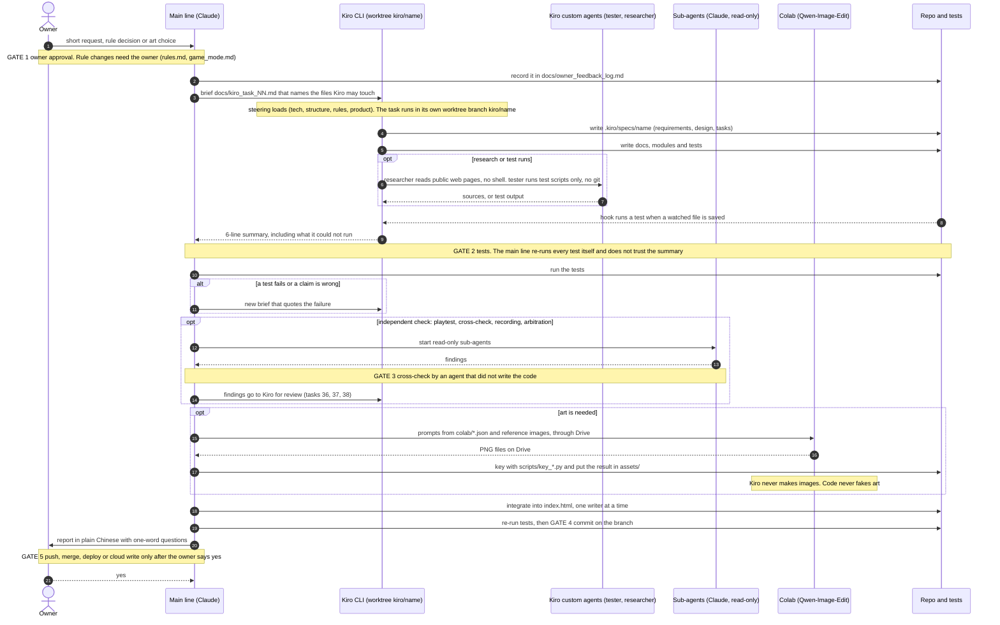

# Workflow (Kiro task 41)

How work really moves on this project: owner, main line (Claude), Kiro, Colab and sub-agents. Drawn from `docs/ROLES.md`, `(not published)`, `.kiro/` and the `docs/kiro_task_*.md` briefs. Git was not used in this task, so branch names and commit history are not checked.
The same content is drawn as `docs/workflow.svg`.

## (a) The loop, with gates

Gates in plain words:

| Gate | Rule | Where it is written |
|---|---|---|
| 1 Owner approval | Rule changes, art choice, merge, push, cloud sync, secrets belong to the owner | `docs/ROLES.md` (Owner row), `.kiro/steering/rules.md` |
| 2 Tests | The main line runs every test itself. A Kiro or sub-agent summary is not proof | `docs/ROLES.md` (Main line row) |
| 3 Cross-check | Independent sub-agents compare the code with `(not published)` | `(not published)` item E1, `docs/converge_crosscheck.md` |
| 4 Commit | One branch per task, `kiro/<name>`. No direct commits to `main` for feature work. Merge only after the tests for the touched area pass | `.kiro/steering/structure.md` |
| 5 Explicit push | Any push or deploy needs the owner to say so | `(not published)` item E5, `docs/ROLES.md` |

## (b) Who does what, and which Kiro feature each step uses

| Step | Who | What happens | Kiro feature | Evidence to open |
|---|---|---|---|---|
| 1 Request | Owner, then main line | Owner gives a short request or a decision. Main line logs it | none | `(not published)` |
| 2 Brief | Main line | Writes a task brief with the exact files Kiro may touch | steering (`structure.md`: "a task brief names the files it may touch") | `docs/kiro_task_01.md` to `kiro_task_41.md` |
| 3 Context | Kiro | Loads four steering files before work | **steering** | `.kiro/steering/product.md`, `tech.md`, `structure.md`, `rules.md` (the last three set `inclusion: always`; `product.md` has no front matter) |
| 4 Isolation | Kiro | Works in its own git worktree and branch per task | **worktree** | `.kiro/steering/structure.md` ("Branches and worktrees"); unmerged branches listed in `(not published)` item E2 |
| 5 Design | Kiro | Writes requirements (EARS wording), design and task checklist before code | **spec** | `.kiro/specs/` (14 folders) |
| 6 Build | Kiro | Writes modules and tests | **custom agent `tester`** (reads and writes in the project, runs only `python3 -B scripts/test_*.py` and `node scripts/test_*.js`, `git`, `curl`, `rm`, `sudo` denied) | `.kiro/agents/tester.json` |
| 7 Research | Kiro | Opens public pages, checks licences, never downloads | **custom agent `researcher`** (web fetch and search allowed, shell denied) | `.kiro/agents/researcher.json`; results in `docs/audio_sources_verified.md`, `docs/audio_generation_options.md`, `docs/halloween_music_candidates.md` (tasks 22, 23, 24) |
| 8 Save check | Kiro, automatically | Saving `index.html` runs `test_mcp_game.py`. Saving `shared/constants.json` or `mcp_game_server.py` runs `test_constants_sync.py`. The rig hook does nothing yet | **hook** | `.kiro/hooks/` (3 files) |
| 9 Review | Kiro agents defined; Claude sub-agents did the recorded reviews | `rules-reviewer` (diff against `rules.md`) and `asset-inventory` (inventory against `assets/`) are read-only | **custom agent** | `.kiro/agents/rules-reviewer.json`, `asset-inventory.json`. Runs of these two are not recorded in the repo. `docs/ROLES.md` names Claude sub-agents for independent reviews |
| 10 Opponent agents | Kiro or any MCP client | Plays the agent side through six tools, public state only | **MCP** | `.kiro/settings/mcp.json`, `scripts/mcp_stdio_server.py`, `docs/mcp_agent_protocol.md`, `scripts/test_mcp_stdio.py`, `scripts/eval_agent_learning.py`. A live match played from Kiro is not recorded |
| 11 Re-verify | Main line | Re-runs every test, reads the diff, does not trust summaries | none | `docs/ROLES.md` |
| 12 Independent checks | Sub-agents (Claude) | Playtest, cross-check of code against the owner log, recording, arbitration | none (Kiro task 38 asks Kiro to start its own sub-agents, or to mark the roles "NOT independent") | `docs/converge_characters.md`, `converge_scenes.md`, `converge_crosscheck.md`, `docs/playtest_20261109.md`, `docs/playtest/`. The output of task 38 is not in this checkout |
| 13 Art | Colab, driven by main line, chosen by owner | Prompts go to Colab, PNGs come back on Drive, scripts key out the magenta background | none. Kiro writes prompts only (tasks 26, 40) | `colab/*.json`, `colab/pumpkin_assets_job.py`, `scripts/key_*.py`, `docs/ASSET_PROVENANCE.md` |
| 14 Integrate | Main line | Wires modules into `index.html`. One writer at a time | none | `docs/ROLES.md` ("Locks") |
| 15 Ship | Owner | Says yes before any push or deploy | none | `(not published)` item E5 |

## (c) How Kiro was used, honestly

The counts below come from listing files in this checkout. Authorship comes from the task briefs and the spec task lists, not from git history, which was not read.

Kiro was given 29 task briefs (`docs/kiro_task_*.md`, numbers 01 to 41 with gaps, including this one). It left 14 spec folders with 40 files (13 folders have requirements, design and tasks; `core-throw-loop` has `requirements.md` only), 4 steering files, 3 hooks, 4 custom agents (`tester` and `researcher` can write, `rules-reviewer` and `asset-inventory` are read-only) and one MCP server entry (`pumpkin-killer`, six tools). By the briefs and specs it wrote 5 browser modules (`js/particles.js`, `js/particles_draw.js`, `js/audio.js`, `js/wind_fx.js`, `js/i18n.js`), the standard MCP server `scripts/mcp_stdio_server.py`, `scripts/postprocess_audio.py`, `colab/audio_job.py` and `css/dock.css`, plus 7 test files (`test_particles.js`, `test_audio.js`, `test_wind_fx.js`, `test_i18n.js`, `test_mcp_stdio.py`, `test_constants_sync.py`, `test_postprocess_audio.py`) and `scripts/eval_agent_learning.py`. `js/ambient_sfx.js` and its test have no brief or spec that names them, so they are not counted. Kiro also wrote the design documents for sound, wind, the dock, the airdrop, the roster, the ultimates and the UI re-skin, and the CC0 source checks. It generated no images: all final art comes from Colab, and the first prototype and early art came from Gemini and Claude before the Kiro credits were approved on 2026-11-04. The main line integrated every module into `index.html` and re-ran every test, because several spec tasks say "not run by the author". Gaps that remain: `index.html` does not talk to the MCP server and still uses an exact-simulator AI; `js/i18n.js` is present but not loaded; the specs `layered-rig` and `physics-pbt` mark `(not published)`, `(not published)` and their tests as done, and none of those files is in this checkout; only 2 of the 3 hooks do anything; `.kiro/steering/tech.md` still states the old wind numbers (48 and 45); `docs/ROLES.md` says Kiro cannot run tests, while the `tester` agent is allowed to.

## Could not verify

- That the SVG and Mermaid blocks render.
- Which `kiro/<name>` branches and worktrees exist (git was not used).
- Whether the `rules-reviewer` and `asset-inventory` agents, or the MCP server from inside Kiro, were ever run.
- Whether any test passes today: no test was run in this task.
